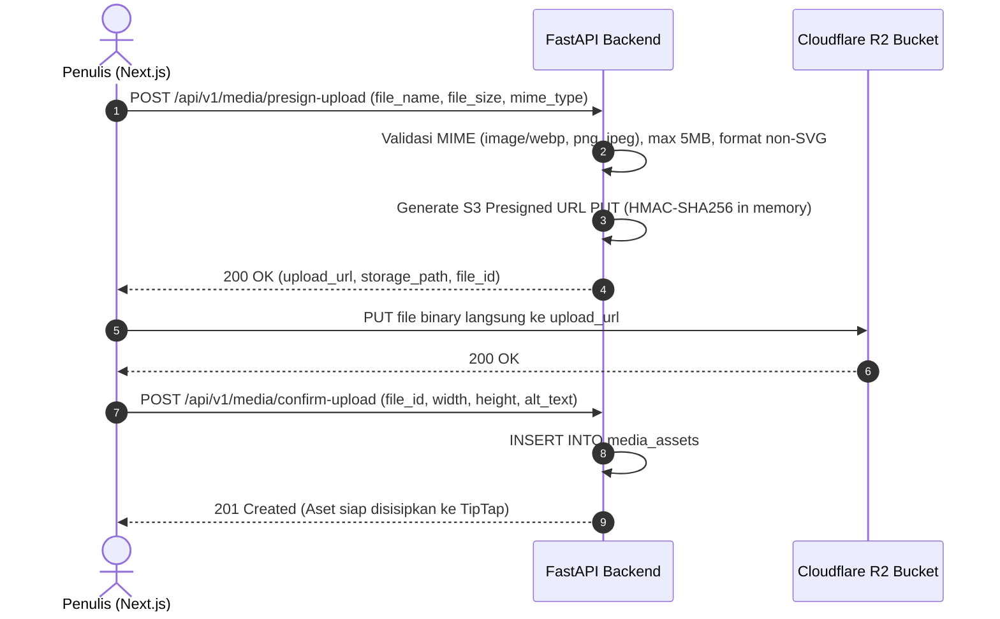

# API Architecture & Endpoint Specification — HIMA IF CMS

| Field | Detail |
|---|---|
| **System** | HIMA IF CMS (Modern WordPress-like Blog Engine) |
| **Document Version** | 3.0.0 |
| **Date** | 2026-10-23 |
| **Status** | Approved Specification |
| **Framework** | Python FastAPI (ASGI) + Pydantic v2 |
| **Base URL** | `/api/v1` |
| **Auth Protocol** | Host-Only Secure HttpOnly Cookie (`__Host-himaif_session`) + Server-Side Session Tracking |

---

## Riwayat Revisi (Revision History)

| Versi | Tanggal | Penulis / Reviewer | Bagian yang Diubah | Rincian Perubahan (Sebelum vs Sesudah) | Alasan Perubahan |
|---|---|---|---|---|---|
| 1.0.0 | 2026-10-13 | Staff Ahli Divisi MIK | Dokumen Baru | Rilis draf awal spesifikasi API arsitektur dual-engine. | Inisiasi baseline API backend. |
| 2.0.0 | 2026-10-14 | Staff Ahli MIK & Auditor | Evaluasi & Keamanan | Penambahan endpoint PIN reset, integrasi Turnstile H-1, evaluasi booking_id, standar Argon2id. | Audit keamanan relasional. |
| 2.1.0 | 2026-10-14 | Staff Ahli MIK & Implementer | Cookie & Rate Limit | Grace period refresh 10s, X-Requested-With CSRF, sliding window rate limiter. | Keputusan resmi Fase 1. |
| 2.2.0 | 2026-10-14 | Staff Ahli MIK & Auditor | BOLA & CAPTCHA | Pencabutan izin divisi ubah kelulusan, Turnstile status verification, field filtering. | Penutupan celah otorisasi. |
| 3.0.0 | 2026-10-23 | Staff Ahli MIK & Antigravity Lead | Seluruh Dokumen | **Sebelum:** Endpoint formulir dinamis (`/forms/*`, `/submissions/*`), booking jadwal wawancara (`/interviews/*`), dan evaluasi kepanitiaan.<br>**Sesudah:** Eliminasi seluruh endpoint form & interview; pemusatan endpoint pada Modul Auth (`/auth/*`), Manajemen User (`/users/*`), Taksonomi (`/categories`, `/tags`), Blog Posts Core (`/posts/*` dengan alur mandiri Author), Media Presigned URL (`/media/*`), dan Audit Logs (`/audit-logs`). Standarisasi cookie `__Host-himaif_session` dan mitigasi CSRF. | Pivot arsitektur WordPress-like Blog CMS murni, eliminasi kompleksitas modul interview, dan persiapan staging deploy. |

---

## 1. Architectural Conventions & Standards

### 1.1 Format Envelope Respons Standar

Seluruh respons API dibungkus dalam format JSON terstandarisasi untuk konsumsi konsisten di frontend Next.js:

```json
{
  "success": true,
  "data": {},
  "message": "Operasi berhasil diselesaikan",
  "meta": {
    "page": 1,
    "limit": 20,
    "total": 54,
    "total_pages": 3
  }
}
```

Format respons error (RFC 9457 compatible):
```json
{
  "success": false,
  "error_code": "RESOURCE_NOT_FOUND",
  "message": "Artikel blog tidak ditemukan",
  "detail": [
    {
      "loc": ["path", "slug_or_id"],
      "msg": "Post with slug 'open-recruitment-2026' not found",
      "type": "not_found"
    }
  ]
}
```

Daftar Kode Error Baku:
- `VALIDATION_ERROR` (422): Payload body/query gagal melewati skema Pydantic.
- `AUTHENTICATION_FAILED` (401): Kredensial tidak valid atau cookie sesi kedaluwarsa.
- `PASSWORD_CHANGE_REQUIRED` (403): Akun berstatus `must_change_password=true`.
- `PERMISSION_DENIED` (403): Pelanggaran hak akses RBAC atau percobaan IDOR.
- `RESOURCE_NOT_FOUND` (404): Entitas tidak ditemukan dalam basis data.
- `RESOURCE_CONFLICT` (409): Slug artikel atau kategori sudah digunakan.
- `RATE_LIMIT_EXCEEDED` (429): Ambang batas frekuensi permintaan terlampaui.
- `INTERNAL_SERVER_ERROR` (500): Galat internal server (pesan teknis disembunyikan).

---

## 2. Katalog Endpoint API

### 2.1 Modul Autentikasi (`/auth`)

| Metode | Path | Hak Akses | Deskripsi & Validasi |
|---|---|---|---|
| `POST` | `/auth/login` | Publik | Autentikasi email/username + password Argon2id. Menerbitkan cookie `__Host-himaif_session`. Rate limit: 5 req/menit per IP. |
| `POST` | `/auth/logout` | Authenticated | Mencabut sesi aktif di Redis dan database, serta menghapus cookie di browser. |
| `GET` | `/auth/me` | Authenticated | Mengambil informasi profil, role (`SUPER_ADMIN` / `AUTHOR`), dan status `must_change_password`. |
| `POST` | `/auth/change-password` | Authenticated | Mengubah kata sandi pengguna (min. 12 karakter). Menghapus bendera `must_change_password` dan menaikkan `auth_epoch`. |

---

### 2.2 Modul Manajemen Pengguna (`/users`) — Khusus Super Admin

| Metode | Path | Hak Akses | Deskripsi & Validasi |
|---|---|---|---|
| `GET` | `/users` | `SUPER_ADMIN` | Menampilkan daftar akun pengurus/penulis, filter role & status aktif, pagination. |
| `POST` | `/users` | `SUPER_ADMIN` | Membuat akun Author baru dengan flag `must_change_password = true`. |
| `GET` | `/users/{id}` | `SUPER_ADMIN` | Mengambil detail akun pengguna spesifik. |
| `PUT` | `/users/{id}` | `SUPER_ADMIN` | Memperbarui nama lengkap, role, atau menonaktifkan akun (`is_active = false`). |
| `POST` | `/users/{id}/reset-password` | `SUPER_ADMIN` | Reset password akun author oleh Super Admin. |

---

### 2.3 Modul Taksonomi: Kategori & Tags (`/categories`, `/tags`)

| Metode | Path | Hak Akses | Deskripsi & Validasi |
|---|---|---|---|
| `GET` | `/categories` | Publik | Daftar kategori artikel aktif beserta jumlah artikel (`post_count`). Di-cache di Redis. |
| `POST` | `/categories` | `SUPER_ADMIN` | Membuat kategori baru (nama, slug unik, deskripsi, warna hex). |
| `PUT` | `/categories/{id}` | `SUPER_ADMIN` | Memperbarui metadata kategori. |
| `DELETE` | `/categories/{id}` | `SUPER_ADMIN` | Menghapus kategori (hanya jika `post_count == 0`). |
| `GET` | `/tags` | Publik | Daftar tag populer untuk penjelajahan topik artikel. |
| `POST` | `/tags` | `SUPER_ADMIN`, `AUTHOR` | Membuat tag baru saat penulisan artikel jika tag belum ada. |

---

### 2.4 Modul Artikel Blog (`/posts`)

| Metode | Path | Hak Akses | Deskripsi & Validasi |
|---|---|---|---|
| `GET` | `/posts` | Publik / Auth | Publik: hanya artikel `PUBLISHED` atau `SCHEDULED` yang `published_at <= NOW()`. Admin/Author: dapat memfilter status (`DRAFT`, `SCHEDULED`, `ARCHIVED`). |
| `GET` | `/posts/{slug_or_id}` | Publik / Auth | Mengambil detail artikel lengkap beserta `content_html` dan `content_json`. Publik menaikkan counter `view_count` via atomic Redis INCR. |
| `POST` | `/posts` | `SUPER_ADMIN`, `AUTHOR` | Membuat artikel baru. Sanitasi HTML via Rust `nh3`, validasi relative URI pada gambar, simpan AST JSONB. |
| `PUT` | `/posts/{id}` | `SUPER_ADMIN`, `AUTHOR` | Memperbarui artikel. **Anti-IDOR Guard**: Author hanya boleh mengedit artikel karyanya sendiri. Menyimpan snapshot revisi ke `blog_post_revisions`. |
| `PATCH` | `/posts/{id}/publish` | `SUPER_ADMIN`, `AUTHOR` | **Alur Mandiri**: Menerbitkan langsung artikel menjadi `PUBLISHED` (`published_at = NOW()`). Author dapat mengeksekusi pada artikel buatannya sendiri. |
| `PATCH` | `/posts/{id}/schedule` | `SUPER_ADMIN`, `AUTHOR` | Menetapkan status `SCHEDULED` dengan parameter `published_at` di masa depan. |
| `PATCH` | `/posts/{id}/archive` | `SUPER_ADMIN` | Mengarsipkan artikel publik agar tidak tampil di feed publik. |
| `DELETE` | `/posts/{id}` | `SUPER_ADMIN`, `AUTHOR` | Menghapus artikel. Author hanya dapat menghapus artikel miliknya sendiri. |
| `GET` | `/posts/{id}/revisions` | `SUPER_ADMIN`, `AUTHOR` | Melihat riwayat revisi artikel untuk audit editorial. |
| `POST` | `/posts/{id}/revisions/{rev_id}/rollback` | `SUPER_ADMIN`, `AUTHOR` | Memulihkan isi artikel ke nomor revisi sebelumnya. |

---

### 2.5 Modul Media & Upload Storage (`/media`)

Pola Direct-to-Storage via **AWS Signature V4 Presigned URL** ke Cloudflare R2 (Zero VPS Egress):



| Metode | Path | Hak Akses | Deskripsi & Validasi |
|---|---|---|---|
| `POST` | `/media/presign-upload` | `SUPER_ADMIN`, `AUTHOR` | Memvalidasi file biner (menolak mutlak ekstensi `.svg`, ukuran maks 5 MB). Menghasilkan Presigned URL PUT Cloudflare R2 berdurasi 5 menit secara lokal di memori. |
| `POST` | `/media/confirm-upload` | `SUPER_ADMIN`, `AUTHOR` | Mengonfirmasi keberhasilan upload biner dan mencatat metadata aset ke tabel `media_assets`. |
| `GET` | `/media` | `SUPER_ADMIN`, `AUTHOR` | Media Library: daftar gambar yang pernah diunggah pengguna. |
| `DELETE` | `/media/{id}` | `SUPER_ADMIN`, `AUTHOR` | Menghapus aset gambar dari Cloudflare R2 dan tabel database (Author hanya bisa menghapus media miliknya). |

---

### 2.6 Modul Log Audit (`/audit-logs`) — Khusus Super Admin

| Metode | Path | Hak Akses | Deskripsi & Validasi |
|---|---|---|---|
| `GET` | `/audit-logs` | `SUPER_ADMIN` | Melihat jejak audit autentikasi, IP address, user-agent, dan peristiwa keamanan dengan filter rentang waktu. |

---

## 3. Spesifikasi Keamanan Parameter Header

Setiap request mutasi data (`POST`, `PUT`, `PATCH`, `DELETE`) dari klien Next.js **wajib menyertakan**:
1. Cookie sesi: `__Host-himaif_session` (disertakan otomatis oleh browser via `withCredentials: true`).
2. Header anti-CSRF: `X-Requested-With: XMLHttpRequest` (memicu preflight CORS jika ada script dari domain asing).
3. Header konten: `Content-Type: application/json`.

Spesifikasi API ini 100% selaras dengan skema database v3.0.0, kebal dari serangan Stored XSS, bebas dari celah IDOR, dan siap diimplementasikan.
