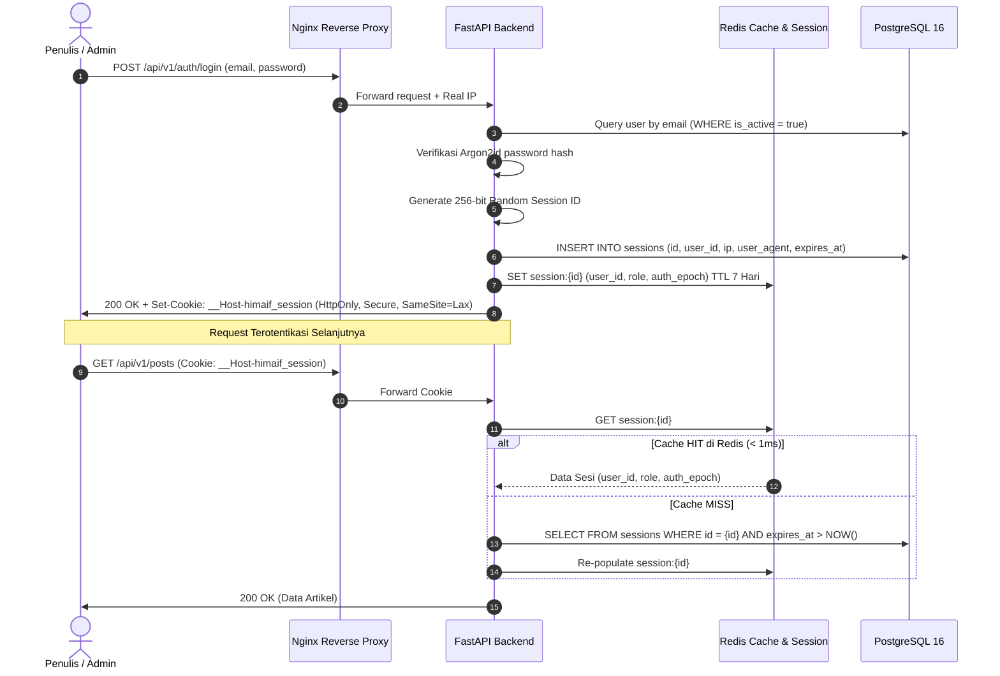

# Authentication & Role-Based Access Control (RBAC) — HIMA IF CMS

| Field | Detail |
|---|---|
| **System** | HIMA IF CMS (Modern WordPress-like Blog Engine) |
| **Document Version** | 3.0.0 |
| **Date** | 2026-10-23 |
| **Status** | Approved Specification |
| **Auth Mechanism** | Username/Email + Argon2id Hash (OWASP) + Session ID Terenkripsi |
| **Session Tracking** | In-Memory (Zustand Client) + Secure Host-Only HttpOnly Cookie + Redis Session Store |

---

## Riwayat Revisi (Revision History)

| Versi | Tanggal | Penulis / Reviewer | Bagian yang Diubah | Rincian Perubahan (Sebelum vs Sesudah) | Alasan Perubahan |
|---|---|---|---|---|---|
| 1.0.0 | 2026-10-13 | Staff Ahli Divisi MIK | Dokumen Baru | Baseline spesifikasi autentikasi pseudo-email dan RBAC 3-role. | Inisiasi dokumen awal. |
| 2.0.0 | 2026-10-14 | Staff Ahli MIK & Auditor | Kriptografi & IDOR | ES256 dual JWT, Argon2id, rotasi refresh token, eliminasi IDOR multi-divisi. | Remediasi audit keamanan Area 1. |
| 2.1.0 | 2026-10-14 | Staff Ahli MIK & Implementer | Grace Period & Rate Limit | Grace period rotasi token 10 detik, user:epoch Redis Cache-Aside, sliding window rate limit. | Keputusan resmi implementasi Fase 1. |
| 2.2.0 | 2026-10-14 | Staff Ahli MIK & Auditor | Matriks RBAC | Pencabutan izin staf divisi ubah kelulusan, adaptasi SQLAlchemy 2.0 Async guard. | Penutupan celah BOLA. |
| 3.0.0 | 2026-10-23 | Staff Ahli MIK & Antigravity Lead | Seluruh Dokumen | **Sebelum:** RBAC 3-role kepanitiaan (`SUPER_ADMIN`, `FORM_MASTER`, `DIVISION_STAFF`), pseudo-email domain internal, proteksi PIN pelamar.<br>**Sesudah:** Rampingkan ke 2 role murni Blog CMS (`SUPER_ADMIN` dan `AUTHOR`), adopsi Alur Mandiri (*Direct Publishing* untuk Author), pengamanan cookie sesi Host-Only (`__Host-himaif_session`), proteksi anti-CSRF khusus sibling subdomain kampus eTLD+1, serta penyatuan session tracking ke 1 instance Redis ramping. | Penyesuaian pivot WordPress-like Blog CMS, eliminasi modul rekrutmen, dan hardening keamanan subdomain universitas. |

---

## 1. Arsitektur Peran & Matriks Otorisasi (RBAC)

Sistem menyederhanakan struktur hak akses menjadi **2 Peran Inti** yang terukur, aman, dan efisien untuk operasional organisasi mahasiswa:

### 1.1 Definisi Peran (Roles)
1. **`SUPER_ADMIN` (Pengurus Harian / PIC Proker Informasite Divisi MIK)**:
   - Pemegang wewenang tertinggi dalam platform.
   - Mengelola akun penulis (tambah, nonaktifkan, reset password author).
   - Mengelola taksonomi global (kategori dan tags).
   - Memiliki wewenang editorial universal (mengedit, mempublikasikan, menurunkan/unpublish, atau menghapus artikel milik siapa pun).
   - Akses penuh ke seluruh Media Library dan Audit Log keamanan.
2. **`AUTHOR` (Staf Divisi MIK / Kontributor Artikel HIMA IF)**:
   - Beroperasi dengan **Alur Kerja Mandiri (*Direct Publishing Workflow*)**.
   - Menulis artikel, mengunggah media/foto untuk artikelnya sendiri, dan menyimpan draft.
   - **Memiliki hak menerbitkan langsung (`PUBLISHED`) dan menjadwalkan (`SCHEDULED`) artikel buatannya sendiri** tanpa perlu menunggu persetujuan Super Admin (mempercepat diseminasi berita kampus).
   - **Terkunci IDOR (Insecure Direct Object Reference)**: Dilarang keras mengedit, mengubah status, atau menghapus artikel milik penulis lain.
   - Dilarang mengelola pengguna, mengubah kategori global, atau melihat log audit sistem.

---

### 1.2 Matriks Hak Akses (Permissions Matrix)

| Modul / Tindakan | Endpoint API | `SUPER_ADMIN` | `AUTHOR` | Keterangan & Aturan Guard |
|---|---|:---:|:---:|---|
| **Auth: Login** | `POST /auth/login` | Ya | Ya | Publik (Rate-limited: 5 req/menit) |
| **Auth: Logout** | `POST /auth/logout` | Ya | Ya | Mencabut sesi aktif di Redis & DB |
| **Auth: Get Current User** | `GET /auth/me` | Ya | Ya | Membaca info profil & role saat ini |
| **Auth: Ganti Password** | `POST /auth/change-password` | Ya | Ya | Wajib password lama (kecuali flag must_change) |
| **User: Kelola Akun Author** | `GET,POST,PUT,DELETE /users/*` | Ya | **Ditolak (403)** | Khusus Super Admin |
| **Blog: Buat Artikel Baru** | `POST /posts` | Ya | Ya | Status awal `DRAFT` atau `PUBLISHED` |
| **Blog: Edit Artikel Sendiri** | `PUT /posts/{id}` | Ya | **Ya (Milik Sendiri)** | Author dibatasi kepemilikan (`author_id == current_user.id`) |
| **Blog: Edit Artikel Orang Lain** | `PUT /posts/{id}` | **Ya** | **Ditolak (403)** | Anti-IDOR Guard di level SQLAlchemy |
| **Blog: Terbitkan Mandiri** | `PATCH /posts/{id}/publish` | Ya | **Ya (Milik Sendiri)** | Menerbitkan langsung artikel buatannya |
| **Blog: Jadwalkan Tayang** | `PATCH /posts/{id}/schedule` | Ya | **Ya (Milik Sendiri)** | Menetapkan `published_at` di masa depan |
| **Blog: Hapus Artikel Sendiri** | `DELETE /posts/{id}` | Ya | **Ya (Milik Sendiri)** | Soft delete / hapus artikel miliknya |
| **Blog: Hapus Artikel Bebas** | `DELETE /posts/{id}` | **Ya** | **Ditolak (403)** | Khusus Super Admin |
| **Taksonomi: Kategori & Tags** | `POST,PUT,DELETE /categories` | **Ya** | **Ditolak (403)** | Author hanya boleh membaca (GET) |
| **Media: Presigned Upload** | `POST /media/presign-upload` | Ya | Ya | Author hanya bisa unggah untuk artikelnya |
| **Media: Hapus Aset Gambar** | `DELETE /media/{id}` | Ya | **Ya (Milik Sendiri)** | Aset milik author bersangkutan |
| **Audit: Lihat Audit Logs** | `GET /audit-logs` | **Ya** | **Ditolak (403)** | Khusus Super Admin |

---

## 2. Manajemen Sesi & Keamanan Cookie

### 2.1 Arsitektur Server-Side Session Tracking

Sistem mengadopsi session tracking berbasis **Token Acak Kriptografis 256-bit (CSPRNG)** yang disimpan di Redis dan PostgreSQL:



---

### 2.2 Spesifikasi Wajib Cookie: Prefix `__Host-` (Isolasi Subdomain Kampus)

Di lingkungan kampus Telkom University, domain `telkomuniversity.ac.id` membawahi ratusan subdomain (`igracias`, `lms`, `openlibrary`, server lab mahasiswa, dll.). Untuk mencegah celah pembajakan sesi lintas-subdomain:

> [!CRITICAL]
> **Aturan Baku Cookie Sesi:**
> 1. **Nama Cookie**: `__Host-himaif_session`.
> 2. **Atribut `Domain` WAJIB DITIADAKAN (`None`)**: Browser mengunci cookie ini secara eksklusif hanya untuk hostname saat ini (`himaif.telkomuniversity.ac.id` atau `himaif.my.id`).
> 3. **Atribut `HttpOnly = true`**: Mencegah JavaScript (bahkan jika ada celah XSS) mengakses cookie sesi.
> 4. **Atribut `Secure = true`**: Browser menolak mengirimkan cookie jika koneksi tidak melalui HTTPS.
> 5. **Atribut `SameSite = "Lax"`**: Mencegah transmisi cookie pada navigasi lintas situs yang berbahaya, namun tetap ramah UX saat admin membuka link dari email/dokumen.
> 6. **Atribut `Path = "/"`**: Diwajibkan oleh spesifikasi browser untuk cookie ber-prefix `__Host-`.

```python
# app/core/auth_cookie.py
from fastapi import Response

def issue_session_cookie(response: Response, session_id: str, max_age_seconds: int = 60 * 60 * 24 * 7):
    response.set_cookie(
        key="__Host-himaif_session",
        value=session_id,
        httponly=True,
        secure=True,
        samesite="lax",
        path="/",
        domain=None,  # DILARANG disetel! Murni Host-Only Cookie
        max_age=max_age_seconds
    )

def clear_session_cookie(response: Response):
    response.delete_cookie(
        key="__Host-himaif_session",
        path="/",
        domain=None
    )
```

---

### 2.3 Perlindungan Anti-CSRF Khusus Sibling Subdomain Kampus

Karena `telkomuniversity.ac.id` berstatus eTLD+1, browser menganggap `lab.telkomuniversity.ac.id` dan `himaif.telkomuniversity.ac.id` berada pada *Site* yang sama (*Same-Site*). Cookie `SameSite=Lax` tetap terkirim pada request POST form sederhana.

**Mitigasi Pertahanan Berlapis (Defense-in-Depth):**
1. **Strict CORS Whitelist**: Backend hanya mengizinkan origin resmi:
   ```python
   ALLOWED_ORIGINS = ["https://himaif.telkomuniversity.ac.id"]
   # Saat staging di Hostinger:
   # ALLOWED_ORIGINS = ["https://himaif.my.id"]
   ```
2. **Kewajiban Custom Header (`X-Requested-With` atau `X-CSRF-Token`)**: Browser melarang skrip lintas origin mengirim custom header tanpa melalui mekanisme preflight OPTIONS.
3. **Middleware Validasi `Sec-Fetch-Site`**:
   ```python
   # app/core/csrf_guard.py
   from fastapi import Request, HTTPException, status
   from starlette.middleware.base import BaseHTTPMiddleware

   class SubdomainCSRFGuard(BaseHTTPMiddleware):
       async def dispatch(self, request: Request, call_next):
           if request.method in ["POST", "PUT", "PATCH", "DELETE"]:
               origin = request.headers.get("origin")
               sec_fetch_site = request.headers.get("sec-fetch-site")

               # Tolak jika request diinisiasi dari sibling subdomain kampus lain
               if sec_fetch_site and sec_fetch_site not in ["same-origin", "none"]:
                   raise HTTPException(
                       status_code=status.HTTP_403_FORBIDDEN,
                       detail="Cross-subdomain request forbidden"
                   )

           return await call_next(request)
   ```

---

## 3. Kebijakan Kredensial & Proteksi Password

### 3.1 Hashing Password Argon2id Standar OWASP
Setiap password pengguna di-hash sebelum disimpan ke tabel `users` menggunakan parameter yang direkomendasikan OWASP:
- **Memory Cost ($m$)**: $19456\text{ KiB}$ (19 MiB)
- **Time Cost ($t$)**: $2$ iterasi
- **Parallelism ($p$)**: $1$ thread
- **Garam Acak (Salt)**: 16 byte unik per akun melalui CSPRNG (`os.urandom(16)`).

### 3.2 Kebijakan Kata Sandi Baru & Guard `must_change_password`
1. Panjang password minimal **12 karakter**, wajib mengandung kombinasi huruf besar, huruf kecil, angka, dan simbol.
2. Pengguna baru (hasil provisioning seed) dibuat dengan flag `must_change_password = true`.
3. Selama bendera ini aktif, pengguna **hanya diizinkan** memanggil endpoint allowlist:
   - `GET /api/v1/auth/me`
   - `POST /api/v1/auth/change-password`
   - `POST /api/v1/auth/logout`
   Seluruh pemanggilan endpoint lain ditolak dengan error `HTTP 403 Forbidden` (`code: MUST_CHANGE_PASSWORD`).

---

## 4. Mekanisme Pencabutan Sesi Instan (*Instant Revocation*)

Saat peristiwa keamanan terjadi (perubahan password, penonaktifan akun, atau pergantian peran oleh Super Admin):
1. Backend menaikkan nilai `auth_epoch = auth_epoch + 1` di tabel `users`.
2. Backend menghapus seluruh baris sesi milik pengguna tersebut di tabel `sessions`.
3. Backend menghapus kunci sesi di Redis:
   `DEL session:{id}` untuk seluruh sesi yang terdaftar atas ID pengguna tersebut.
4. Pada request berikutnya, sesi pengguna lama langsung tertolak seketika (*fail-closed*), memaksa re-autentikasi dengan kredensial baru.

Spesifikasi ini memastikan kontrol hak akses yang ketat, kemudahan alur kerja penulis, dan perlindungan penuh terhadap seluruh ancaman jaringan kampus.
