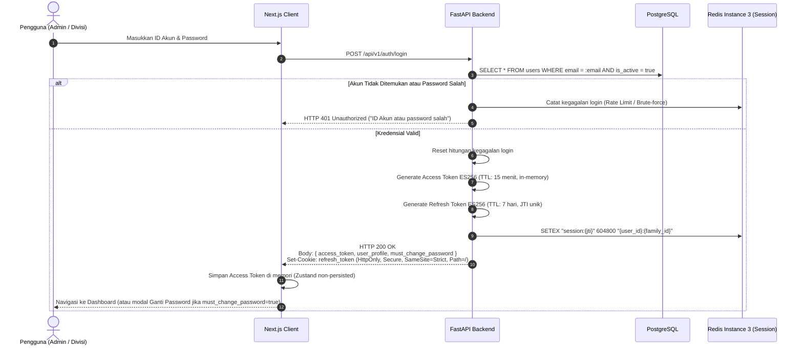
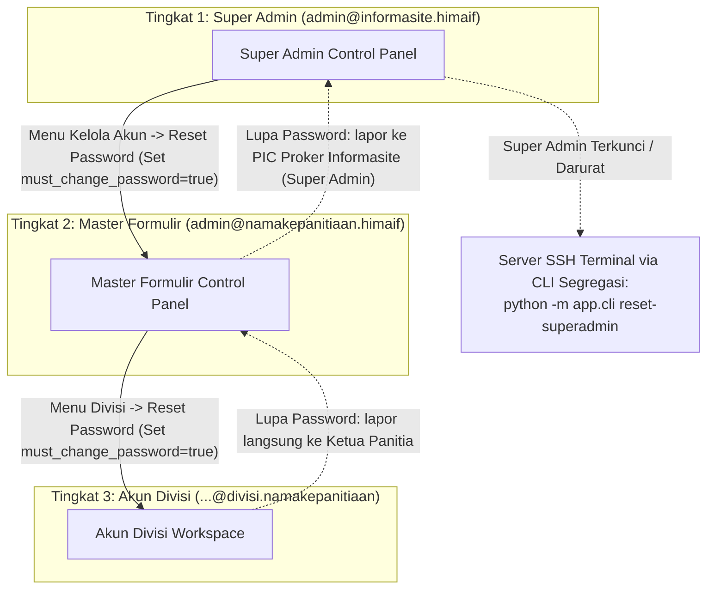

# Authentication & Role-Based Access Control (RBAC) — HIMA IF CMS

| Field | Detail |
|---|---|
| **System** | HIMA IF CMS |
| **Document Version** | 2.0.0 |
| **Date** | 14 October 2026 |
| **Status** | Approved Specification |
| **Auth Mechanism** | Pseudo-Account Identifier + Argon2id Hash (OWASP) + Asymmetric Dual JWT (ES256) |
| **Session Tracking** | In-Memory (Zustand) + Secure HttpOnly Cookie + Redis Instance 3 (Session & Rate Limit) |

---

## Riwayat Revisi (Revision History)

| Versi | Tanggal | Penulis | Ringkasan Perubahan | Alasan |
|---|---|---|---|---|
| 1.0.0 | 13 Oktober 2026 | Staff Ahli Divisi MIK (Proker Informasite) | Draf awal spesifikasi autentikasi dan RBAC. | Inisiasi baseline autentikasi sistem. |
| 2.0.0 | 14 Oktober 2026 | Staff Ahli Divisi MIK & Antigravity Auditor | Pembaruan kriptografi ke asimetris ES256, hashing Argon2id (OWASP), rotasi refresh token dengan deteksi reuse `jti`, penanganan UX navigasi `SameSite=Strict`, guard `must_change_password` (min 12 karakter), perbaikan celah IDOR multi-divisi (`primary` & `secondary`), dan isolasi hak akses PIN pelamar. | Remediasi temuan audit keamanan (Area 1: Security & Cleanliness). |

---

## 1. Konsep & Arsitektur Pseudo-Account

Sistem autentikasi HIMA IF CMS **tidak menggunakan email sungguhan** dan **tidak membutuhkan mail server (SMTP), DNS MX record, atau layanan verifikasi email pihak ketiga**. Semua identitas akun merupakan *pseudo-email login identifier* internal yang berfungsi murni sebagai username terstruktur.

### 1.1 Hierarki dan Format Akun

| Role Enum | Format Identifier | Cakupan Akses (Scope) | Hak Akses PIN Pelamar | Hak Reset Password Akun |
|---|---|---|---|---|
| `SUPER_ADMIN` | `admin@informasite.himaif` | Dipegang oleh PIC Proker Informasite (Staff Ahli Divisi MIK). Seluruh sistem: blog, formulir, divisi, pendaftar, evaluasi, dan audit log global. | Bisa melihat & mereset PIN pelamar mana pun (tercatat audit log). | Dapat mereset password akun mana pun dalam sistem. |
| `FORM_MASTER` | `admin@namakepanitiaan.himaif`<br>*(cth: `admin@pemiluif.himaif`)* | Hanya formulir miliknya: konfigurasi form, kelola divisi, rekap pendaftar, dan rekap interview seluruh divisi miliknya. | Bisa melihat & mereset PIN pelamar pada form miliknya (tercatat audit log). | Hanya dapat mereset password akun divisi (`DIVISION_STAFF`) di bawah formulirnya. |
| `DIVISION_STAFF` | `...@divisi.namakepanitiaan`<br>*(cth: `acara@divisi.pemiluif`)* | Hanya divisinya sendiri: pendaftar divisinya, jadwal interview divisi, pertanyaan kustom, dan penilaian kandidat. | **Dilarang keras** melihat atau mereset PIN pelamar (selalu di-*redact*). | Hanya dapat mengubah password akunnya sendiri jika mengetahui password lama. |

### 1.2 Validasi Identifier & Keamanan Kredensial

1. **Custom Pydantic PseudoEmail Type**:
   Backend menggunakan validator regex terisolasi yang meloloskan format domain internal himaif tanpa dependensi DNS:
   ```python
   PSEUDO_EMAIL_REGEX = r"^[a-zA-Z0-9_.+-]+@([a-zA-Z0-9-]+\.)*([a-zA-Z0-9-]+)$"
   ```
2. **Frontend Input Mode**:
   Form login di frontend menggunakan `<input type="text" autocomplete="username">` berlabel "ID Akun Internal", bukan `<input type="email">` agar tidak memicu pesan error native HTML5 browser.
3. **Password Hashing Standar OWASP**:
   Password disimpan menggunakan algoritma **Argon2id** dengan konfigurasi minimum:
   - Memory cost ($m$): $19456\text{ KiB}$ (19 MiB)
   - Time cost ($t$): $2$ iterasi
   - Parallelism ($p$): $1$ thread
   - Garam acak kriptografis (salt) 16 bytes per akun via CSPRNG.
4. **Kebijakan Password Awal & Rotasi Wajib**:
   - Akun yang baru digenerate secara otomatis (Master Form atau Divisi) memiliki bendera `must_change_password = true`.
   - Panjang minimum password baru adalah **12 karakter**.
   - Pengguna dengan status `must_change_password = true` dibatasi hanya dapat mengakses endpoint allowlist hingga password diperbarui melalui `POST /api/v1/auth/change-password`.

---

## 2. Alur Token JWT & Manajemen Sesi

Sistem menerapkan arsitektur **Asymmetric Dual-Token JWT (ES256)** dengan pemisahan kunci:
- **Private Key (ECDSA P-256)** disimpan secara rahasia di backend FastAPI untuk menandatangani token.
- **Public Key** dibagikan ke Next.js (Edge/Node runtime) untuk verifikasi token independen tanpa perlu meminta verifikasi ke backend untuk setiap operasi routing UI.



### 2.1 Struktur Klaim Token

#### A. Refresh Token (Disimpan di HttpOnly Cookie)
Refresh token merupakan signed JWT bertanda tangan ES256 dengan payload:
```json
{
  "sub": "b2c1404e-2895-46eb-8e99-8cfefea91f21",
  "role": "DIVISION_STAFF",
  "division_id": "c7a884fa-3882-411a-a1b7-a846f3a61201",
  "must_change_password": false,
  "type": "refresh",
  "iss": "himaif-cms-backend",
  "aud": "himaif-cms-api",
  "jti": "e4d3c2b1-0987-4321-abcd-ef0123456789",
  "iat": 1791900000,
  "exp": 1792504800
}
```

#### B. Access Token (Disimpan In-Memory di Frontend Zustand)
Access token merupakan signed JWT bertanda tangan ES256 dengan payload:
```json
{
  "sub": "b2c1404e-2895-46eb-8e99-8cfefea91f21",
  "email": "acara@divisi.pemiluif",
  "role": "DIVISION_STAFF",
  "form_id": "9a1e94cf-133a-4467-9bf4-e221b22e11d2",
  "division_id": "c7a884fa-3882-411a-a1b7-a846f3a61201",
  "must_change_password": false,
  "auth_epoch": 1,
  "type": "access",
  "iss": "himaif-cms-backend",
  "aud": "himaif-cms-api",
  "jti": "a1b2c3d4-1234-5678-9abc-def012345678",
  "iat": 1791900000,
  "exp": 1791900900
}
```

### 2.2 Rotasi Refresh Token & Deteksi Pemakaian Ulang (Reuse Detection)
1. Setiap kali klien memanggil `POST /api/v1/auth/refresh`:
   - Klien mengirim cookie `refresh_token`.
   - FastAPI memverifikasi tanda tangan ES256 dan memastikan klaim `type == "refresh"` serta `aud == "himaif-cms-api"`.
   - Backend memeriksa keberadaan `jti` di Redis Instance 3.
   - **Jika `jti` tidak ditemukan / sudah pernah dicabut:** Sistem mendeteksi adanya potensi pencurian token (*token replay attack*). Seluruh sesi dalam satu `family_id` langsung dicabut seketika, dan `auth_epoch` akun dinaikkan.
   - **Jika valid:** `jti` lama dihapus dari Redis, lalu pasangan token baru diterbitkan dengan `jti` baru yang disimpan kembali di Redis.
2. **Masa Berlaku Token:**
   - **Access Token (15 Menit):** Membatasi rentang paparan jika terjadi kompromi memori dan memastikan hak akses/status `auth_epoch` dicek secara reguler.
   - **Refresh Token (7 Hari):** Memberikan kenyamanan kerja bagi panitia selama masa rekrutmen tanpa harus login berulang kali setiap jam.

### 2.3 Interaksi Cookie `SameSite=Strict` dan Routing Next.js
1. **Peran Next.js Routing Layer:**
   Lapisan routing Next.js (`src/middleware.ts`) membaca cookie `refresh_token` **hanya untuk keputusan navigasi antarmuka (UX routing)**, misalnya mencegah halaman blank sebelum redirect. Next.js memverifikasi keaslian cookie menggunakan ES256 Public Key. Next.js **tidak** melakukan mutasi state otorisasi data atau bypass pengujian hak akses backend FastAPI.
2. **Mitigasi Navigasi Eksternal:**
   Atribut `SameSite=Strict` mencegah pengiriman cookie saat navigasi lintas-situs tingkat atas (misalnya panitia mengklik tautan dashboard dari obrolan WhatsApp Web).
   *Solusi Teknis:* Halaman target admin Next.js merender antarmuka interstitial aman yang segera memicu request internal same-origin (`POST /api/v1/auth/refresh`) melalui JavaScript browser. Karena pemanggilan berasal dari same-origin, browser secara otomatis menyertakan cookie `refresh_token`, sesi dipulihkan seketika, dan pengguna langsung dialihkan ke dashboard tanpa perlu memasukkan password kembali.
3. **Validasi Origin & CSRF Defense-in-Depth:**
   Seluruh endpoint mutasi (`POST`, `PUT`, `PATCH`, `DELETE`) di FastAPI memvalidasi header `Origin` atau `Referer` terhadap domain resmi organisasi (`https://himaif.id`) guna memastikan proteksi CSRF berlapis.

---

## 3. Matriks Hak Akses Terperinci (RBAC Matrix)

| Fitur / Modul Operasional | Super Admin (`SUPER_ADMIN`) | Master Formulir (`FORM_MASTER`) | Akun Divisi (`DIVISION_STAFF`) | Public / Mahasiswa Pendaftar |
|---|:---:|:---:|:---:|:---:|
| **Blog CMS** | | | | |
| Baca artikel blog terbit | :white_check_mark: | :white_check_mark: | :white_check_mark: | :white_check_mark: |
| Buat / edit / hapus blog | :white_check_mark: | :x: | :x: | :x: |
| Publikasi / jadwalkan blog | :white_check_mark: | :x: | :x: | :x: |
| Kelola kategori blog | :white_check_mark: | :x: | :x: | :x: |
| **Formulir Engine** | | | | |
| Buat acara / formulir baru | :white_check_mark: | :x: *(Dibuat oleh Super Admin)* | :x: | :x: |
| Edit info form miliknya | :white_check_mark: | :white_check_mark: *(Form miliknya)* | :x: | :x: |
| Tambah / ubah field custom | :white_check_mark: | :white_check_mark: *(Form miliknya)* | :x: | :x: |
| Isi & submit form publik | :x: | :x: | :x: | :white_check_mark: *(Turnstile)* |
| Cek status pendaftaran mandiri | :x: | :x: | :x: | :white_check_mark: *(Code + NIM + PIN)* |
| Reschedule interview mandiri | :x: | :x: | :x: | :white_check_mark: *(Maks H-1)* |
| **Manajemen Divisi & Akun** | | | | |
| Tambah divisi & auto-generate akun | :white_check_mark: | :white_check_mark: *(Form miliknya)* | :x: | :x: |
| Reset password akun divisi | :white_check_mark: | :white_check_mark: *(Divisi miliknya)* | :x: | :x: |
| Reset password Master Formulir | :white_check_mark: | :x: | :x: | :x: |
| Reset password Super Admin | :white_check_mark: *(Super Admin lain / CLI)* | :x: | :x: | :x: |
| **Pendaftar & Submisi** | | | | |
| Lihat pendaftar semua divisi | :white_check_mark: | :white_check_mark: *(Form miliknya)* | :x: | :x: |
| Lihat pendaftar khusus divisinya | :white_check_mark: | :white_check_mark: | :white_check_mark: *(Divisi 1 atau 2)* | :x: |
| Lihat `tracking_pin` pelamar | :white_check_mark: *(Audit logged)* | :white_check_mark: *(Form miliknya, Audit logged)* | :x: *(Dilarang keras)* | :x: *(Hanya saat submit)* |
| Reset `tracking_pin` pelamar | :white_check_mark: *(Audit logged)* | :white_check_mark: *(Form miliknya, Audit logged)* | :x: *(Dilarang keras)* | :x: |
| Unduh berkas / CV pelamar | :white_check_mark: *(Presigned)* | :white_check_mark: *(Form miliknya)* | :white_check_mark: *(Divisinya saja)* | :x: |
| Ubah status akhir pelamar | :white_check_mark: | :white_check_mark: *(Form miliknya)* | :white_check_mark: *(Divisi terkait)* | :x: |
| **Interview & Evaluasi** | | | | |
| Konfigurasi rentang jadwal divisi | :white_check_mark: | :white_check_mark: *(Form miliknya)* | :white_check_mark: *(Divisinya)* | :x: |
| Blokir / unblock slot interview | :white_check_mark: | :white_check_mark: *(Form miliknya)* | :white_check_mark: *(Divisinya)* | :x: |
| Susun butir pertanyaan custom | :white_check_mark: | :white_check_mark: *(Form miliknya)* | :white_check_mark: *(Divisinya)* | :x: |
| Nilai kandidat per `booking_id` | :white_check_mark: | :white_check_mark: | :white_check_mark: *(Divisi pemilik booking)* | :x: |
| Kunci rekomendasi final (Pleno) | :white_check_mark: | :white_check_mark: *(Keputusan akhir)* | :white_check_mark: *(Rekomendasi)* | :x: |
| **Ekspor & Audit** | | | | |
| Ekspor data pendaftar (XLSX/CSV) | :white_check_mark: *(Audit logged)* | :white_check_mark: *(Form miliknya, Audit logged)* | :x: | :x: |
| Ekspor rekap nilai interview | :white_check_mark: *(Audit logged)* | :white_check_mark: *(Form miliknya, Audit logged)* | :white_check_mark: *(Divisinya saja)* | :x: |
| Lihat security audit log global | :white_check_mark: | :x: | :x: | :x: |

---

## 4. Mekanisme Proteksi IDOR & Otorisasi Bertingkat

Untuk mencegah kerentanan Insecure Direct Object References (IDOR), backend FastAPI menyediakan dependency guards independen:

### 4.1 Validasi Akses Pendaftar (Primary & Secondary Division Support)
```python
# app/core/security_guards.py
from fastapi import Depends, HTTPException, status
from sqlalchemy.orm import Session
from app.core.database import get_db
from app.models.user import User, UserRole
from app.models.form import FormSubmission, FormDivision

def verify_submission_access(
    submission_id: str,
    current_user: User = Depends(get_current_user),
    db: Session = Depends(get_db)
) -> FormSubmission:
    submission = db.query(FormSubmission).filter(FormSubmission.id == submission_id).first()
    if not submission:
        raise HTTPException(status_code=status.HTTP_404_NOT_FOUND, detail="Data pendaftar tidak ditemukan")
        
    if current_user.role == UserRole.SUPER_ADMIN:
        return submission
        
    if current_user.role == UserRole.FORM_MASTER:
        if submission.form.master_user_id != current_user.id:
            raise HTTPException(status_code=status.HTTP_403_FORBIDDEN, detail="Akses ditolak: di luar kepanitiaan Anda")
        return submission
        
    if current_user.role == UserRole.DIVISION_STAFF:
        # Pendaftar boleh dilihat oleh Divisi 1 maupun Divisi 2
        allowed_divisions = {submission.primary_division_id, submission.secondary_division_id}
        if current_user.division_id not in allowed_divisions:
            raise HTTPException(status_code=status.HTTP_403_FORBIDDEN, detail="Akses ditolak: pendaftar di luar divisi Anda")
        return submission
        
    raise HTTPException(status_code=status.HTTP_403_FORBIDDEN, detail="Izin tidak mencukupi")
```

### 4.2 Validasi Akses Evaluasi Booking Interview
```python
def verify_booking_evaluator(
    booking_id: str,
    current_user: User = Depends(get_current_user),
    db: Session = Depends(get_db)
):
    from app.models.interview import InterviewBooking
    booking = db.query(InterviewBooking).filter(InterviewBooking.id == booking_id).first()
    if not booking:
        raise HTTPException(status_code=status.HTTP_404_NOT_FOUND, detail="Booking interview tidak ditemukan")
        
    if current_user.role == UserRole.SUPER_ADMIN:
        return booking
        
    if current_user.role == UserRole.FORM_MASTER:
        if booking.submission.form.master_user_id != current_user.id:
            raise HTTPException(status_code=status.HTTP_403_FORBIDDEN, detail="Akses ditolak: bukan kepanitiaan Anda")
        return booking
        
    if current_user.role == UserRole.DIVISION_STAFF:
        # Penilaian hanya dapat dilakukan oleh staf dari divisi yang dijadwalkan pada booking ini
        if booking.division_id != current_user.division_id:
            raise HTTPException(status_code=status.HTTP_403_FORBIDDEN, detail="Akses ditolak: booking bukan untuk divisi Anda")
        return booking
        
    raise HTTPException(status_code=status.HTTP_403_FORBIDDEN, detail="Izin tidak mencukupi")
```

---

## 5. Mekanisme Reset Password Hierarkis & Darurat

Proses pemulihan akun tanpa mail server berlangsung melalui delegasi hierarki terkontrol:



### Prosedur Darurat CLI Server:
Jika kredensial akun Super Admin hilang atau terkunci:
```bash
docker compose exec backend python -m app.cli reset-superadmin \
  --email admin@informasite.himaif \
  --new-password "SecurePass2026!"
```
Perintah ini akan secara otomatis:
1. Memvalidasi bahwa password baru memenuhi batas minimal 12 karakter.
2. Menghash dengan Argon2id ($m=19456\text{ KiB}, t=2, p=1$).
3. Menaikkan nilai `auth_epoch` akun Super Admin untuk memutus sesi aktif yang mungkin telah terkompromi.
4. Mencatat peristiwa intervensi fisik tersebut ke dalam file audit sistem.
