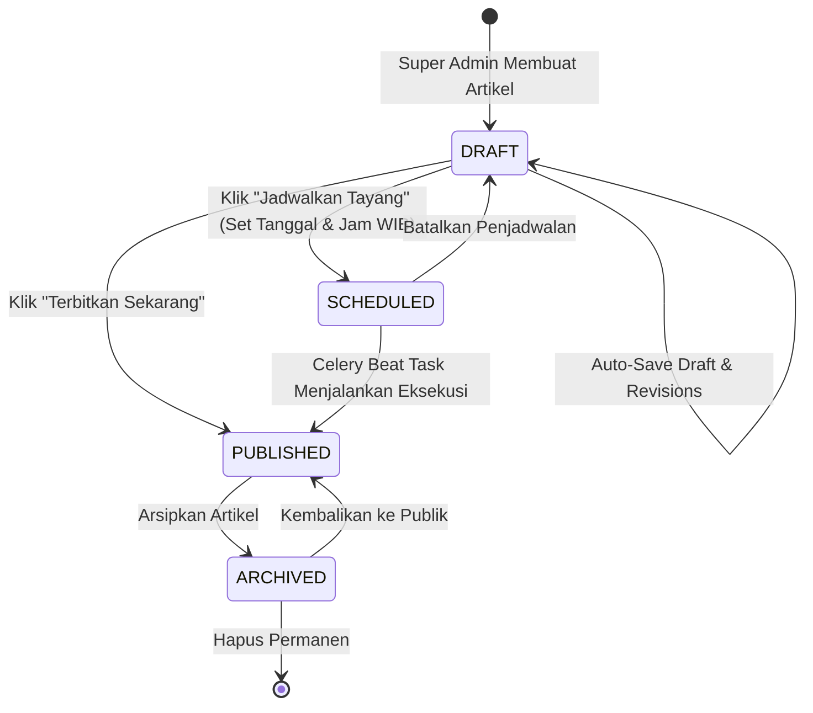
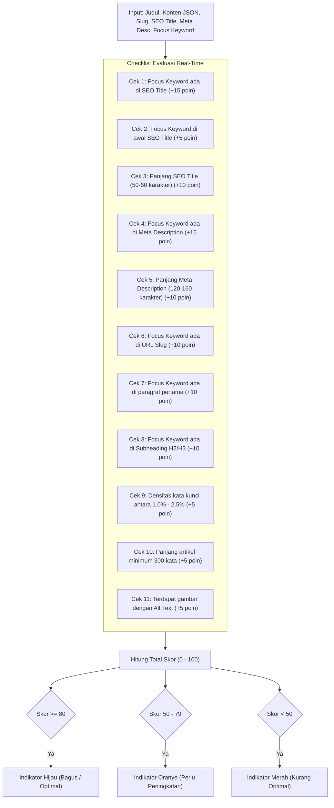

# Modul Blog CMS & Block Editor Engine — HIMA IF CMS

| Field | Detail |
|---|---|
| **System** | HIMA IF CMS |
| **Document Version** | 2.0.0 |
| **Date** | 14 October 2026 |
| **Status** | Approved Specification |
| **Editor Engine** | TipTap (ProseMirror Headless Architecture) |
| **Scheduler Engine** | Celery Beat 5.4+ + Redis Instance 2 (Broker) |
| **Cache Strategy** | Redis Instance 1 (Version Tag Invalidation $O(1)$) |
| **Access Scope** | Eksklusif `SUPER_ADMIN` |

---

## Riwayat Revisi (Revision History)

| Versi | Tanggal | Penulis | Ringkasan Perubahan | Alasan |
|---|---|---|---|---|
| 1.0.0 | 13 Oktober 2026 | Staff Ahli Divisi MIK (Proker Informasite) | Draf awal arsitektur modul blog dan block editor. | Inisiasi spesifikasi CMS blog organisasi. |
| 2.0.0 | 14 Oktober 2026 | Staff Ahli Divisi MIK & Antigravity Auditor | Pembaruan sanitasi server-side ke pustaka Rust modern `nh3` (menggantikan `bleach` yang telah deprecated), migrasi invalidasi scheduler ke Version Tag Invalidation $O(1)$ (menghapus `delete_pattern`), peringkasan spesifikasi thumbnail dengan merujuk kanonikal ke `IMAGE_OPTIMIZATION_PERFORMANCE.md`, dan penegasan scope RBAC eksklusif `SUPER_ADMIN`. | Mitigasi Stored XSS, penghapusan CPU blocking di Redis, dan konsistensi modul. |

---

## 1. WordPress-Equivalent Block Editor Architecture

Modul Blog dirancang untuk menyamai fleksibilitas dan kenyamanan **WordPress Gutenberg**, menggunakan framework headless editor **TipTap** (berbasis ProseMirror). Editor ini menghasilkan representasi dokumen berupa **struktur pohon JSON (JSONB)** yang aman dari eksekusi script berbahaya (*Stored XSS*). Pengelolaan artikel blog dibatasi **eksklusif untuk SUPER_ADMIN**.

### 1.1 Daftar Blok yang Didukung

```mermaid
graph TD
    Root["Dokumen Blog (ProseMirror JSON)"]
    
    Root --> TextGroup["Grup Blok Teks"]
    TextGroup --> H["Heading (H1, H2, H3, H4) + Auto Anchor ID"]
    TextGroup --> P["Paragraf (Styling: Bold, Italic, Strikethrough, Underline, Inline Code, Text Color)"]
    TextGroup --> Align["Perataan Teks (Align Left, Center, Right, Justify)"]
    
    Root --> MediaGroup["Grup Blok Media"]
    MediaGroup --> Img["Gambar Tunggal (Alt Text, Caption, Ukuran & Align)"]
    MediaGroup --> Gal["Galeri Gambar (Grid Responsif 2-4 Kolom, Lightbox)"]
    MediaGroup --> Embed["Embed Media (YouTube, Google Slides, Spotify)"]
    
    Root --> LayoutGroup["Grup Blok Tata Letak & Khusus"]
    LayoutGroup --> HTML["Custom HTML (Raw Code Sandbox + Sanitasi nh3)"]
    LayoutGroup --> Q["Kutipan / Blockquote (Quote Text + Atribusi Penulis)"]
    LayoutGroup --> L["Daftar / List (Bullet List, Numbered List, Checklist)"]
    LayoutGroup --> T["Tabel Data (Baris, Kolom, Header Toggle, Cell Alignment)"]
    LayoutGroup --> Alert["Callout Box (Info, Warning, Success, Tips)"]
    LayoutGroup --> Code["Blok Kode Program (Syntax Highlighting)"]
    LayoutGroup --> Div["Pemisah Horizontal / Divider"]
```



### 1.2 Skema Data JSON Blok TipTap
Setiap artikel disimpan di kolom `blog_posts.content_blocks` dengan format standar:

```json
{
  "type": "doc",
  "content": [
    {
      "type": "heading",
      "attrs": { "level": 2, "id": "tujuan-open-recruitment" },
      "content": [{ "type": "text", "text": "Tujuan Open Recruitment 2026" }]
    },
    {
      "type": "paragraph",
      "attrs": { "textAlign": "left" },
      "content": [
        { "type": "text", "text": "HIMA IF membuka kesempatan bagi mahasiswa angkatan " },
        { "type": "text", "marks": [{ "type": "bold" }], "text": "2024 dan 2025" },
        { "type": "text", "text": " untuk bergabung menjadi bagian dari kepengurusan." }
      ]
    },
    {
      "type": "customHtml",
      "attrs": {
        "htmlContent": "<div class=\"p-4 bg-emerald-50 text-emerald-800 rounded-lg\">Informasi lengkap dapat diakses melalui portal resmi himaif.id</div>"
      }
    }
  ]
}
```

### 1.3 Pengamanan Blok Custom HTML (Dual-Layer Sanitization)
Fitur *Custom HTML* memberikan fleksibilitas penataan visual namun berpotensi membuka celah injeksi script (*Stored XSS*).
Sistem menerapkan **Dual-Layer HTML Sanitization**:
1. **Frontend Sanitization (Next.js)**: Sebelum dirender ke DOM, konten blok HTML diproses menggunakan `DOMPurify` dengan allowlist tag yang ketat (mengizinkan `div, span, table, p, a, b, i, img, svg`, melarang mutlak `<script>`, `<iframe>` tidak terdaftar, `onload`, dan event handler inline lainnya).
2. **Backend Sanitization (FastAPI)**: Pada endpoint penyimpanan dan pembaruan artikel (`POST`/`PUT /api/v1/blog/admin/posts`), backend memvalidasi dan membersihkan HTML menggunakan library Python modern berbasis Rust **`nh3`** (menggantikan library `bleach` yang telah didepresiasi di ekosistem Python):
   ```python
   # app/services/blog_service.py
   import nh3

   ALLOWED_TAGS = {"p", "b", "i", "u", "a", "div", "span", "table", "thead", "tbody", "tr", "th", "td", "ul", "ol", "li", "h1", "h2", "h3", "h4", "blockquote", "code", "pre", "hr", "br"}
   ALLOWED_ATTRIBUTES = {
       "a": {"href", "target", "rel"},
       "*": {"class", "style", "id"}
   }

   def sanitize_custom_html(raw_html: str) -> str:
       return nh3.clean(
           raw_html,
           tags=ALLOWED_TAGS,
           attributes=ALLOWED_ATTRIBUTES,
           url_schemes={"http", "https", "mailto"}
       )
   ```

---

## 2. Alur Draft, Schedule, Revisions & Publish

Artikel blog melalui siklus hidup state machine yang ketat:



### 2.1 Mekanisme Riwayat Revisi (Post Revisions)
Setiap kali artikel disimpan (`PUT /api/v1/blog/admin/posts/{id}`):
1. Snapshot judul dan `content_blocks` lama disalin ke tabel `blog_post_revisions`.
2. Maksimum 30 revisi terakhir disimpan per artikel (revisi tertua di-*prune* secara otomatis).
3. Penulis dapat melihat daftar revisi, membandingkan perbedaan (*visual diff*), dan melakukan *one-click rollback*.

### 2.2 Mesin Publikasi Terjadwal & Invalidasi Cache $O(1)$
Ketika artikel dijadwalkan:
- Status diubah menjadi `SCHEDULED` dengan timestamp `scheduled_at` (dalam zona waktu `Asia/Jakarta`, disimpan UTC di PostgreSQL).
- Worker background `Celery Beat` mengecek setiap **60 detik**:
  ```python
  # app/tasks/blog_scheduler.py
  from datetime import datetime, timezone
  from app.core.redis import redis_cache_client
  from app.models.blog import BlogPost, PostStatus

  @celery_app.task
  def publish_scheduled_posts():
      now = datetime.now(timezone.utc)
      posts = db.query(BlogPost).filter(
          BlogPost.status == PostStatus.SCHEDULED,
          BlogPost.scheduled_at <= now
      ).with_for_update(skip_locked=True).all()
      
      if not posts:
          return
          
      for post in posts:
          post.status = PostStatus.PUBLISHED
          post.published_at = post.scheduled_at
          # Hapus cache spesifik artikel
          redis_cache_client.delete(f"cms:blog:post:{post.slug}")
      
      # Inkrementasi version tag untuk menginvalidasi seluruh list blog O(1)
      redis_cache_client.incr("cms:blog:version:list")
      db.commit()
  ```

---

## 3. Ketentuan Thumbnail & Pipeline Gambar

Spesifikasi detail rasio, dimensi, optimasi multi-resolusi WebP/AVIF, serta proteksi anti-decompression bomb mengikuti dokumen kanonikal:
👉 **[IMAGE_OPTIMIZATION_PERFORMANCE.md](file:///C:/College%20%28Telkom%20University%29/Projects/Website/himaiftelkomuniv/new_md/IMAGE_OPTIMIZATION_PERFORMANCE.md)**

### Ringkasan Parameter Utama Thumbnail Blog:
1. **Rasio Aspek Konsisten**: Wajib 16:9 pada seluruh thumbnail card dan header detail banner.
2. **Ukuran File**: Target < 30 KB untuk preview card, dan < 100 KB untuk header banner detail.
3. **Pembangkitan LQIP Base64**: String base64 16x9 px disimpan pada metadata artikel untuk menjamin *Zero Layout Shift* (CLS = 0) di Next.js `<Image placeholder="blur">`.
4. **Engine Kompresi**: Menggunakan library Python Pillow dengan pembatasan ketat `Image.MAX_IMAGE_PIXELS = 16_777_216`.

---

## 4. Mesin Evaluasi SEO & Real-Time Feedback

Di panel editor artikel, terdapat sidebar **SEO Engineering** yang berfungsi seperti plugin Yoast SEO / RankMath di WordPress. Sistem menganalisis teks secara real-time saat penulis mengetik.

### 4.1 Parameter Input SEO
- **SEO Title**: Judul yang muncul di tab browser dan hasil pencarian Google (disarankan 50–60 karakter).
- **Meta Description**: Ringkasan artikel untuk snippet mesin pencari (disarankan 120–160 karakter).
- **Focus Keyword**: Kata kunci utama yang ingin dioptimasi (cth: "Oprec HIMA IF").
- **Slug**: URL ramah mesin pencari (cth: `oprec-hima-if-2026`).

### 4.2 Algoritma Penilaian SEO (Skala 0 - 100)



### 4.3 Tampilan Feedback & Rekomendasi Actionable di Sidebar Editor
Editor menyediakan tab evaluasi dengan rincian status:
- :white_check_mark: **Hijau**: Kata kunci fokus ditemukan di judul artikel dan URL slug.
- :white_check_mark: **Hijau**: Meta description memiliki panjang ideal (142 karakter).
- :warning: **Oranye**: Kepadatan kata kunci 0.6% (sedikit terlalu rendah, ulangi kata kunci 1-2 kali lagi).
- :x: **Merah**: Tidak ada gambar dalam konten yang memiliki atribut Alt Text dengan kata kunci fokus.
- :x: **Merah**: Panjang artikel hanya 180 kata (rekomendasi minimal 300 kata).
- **Google Search Snippet Preview**: Menampilkan simulasi tampilan hasil pencarian desktop dan mobile secara interaktif.
