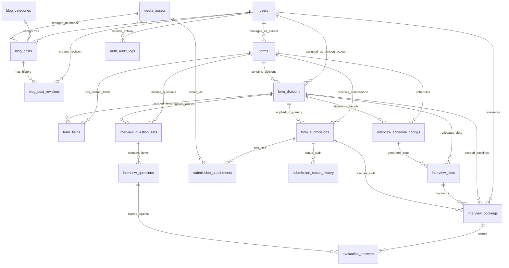

# Database Architecture & Schema Specification — HIMA IF CMS

| Field | Detail |
|---|---|
| **System** | HIMA IF CMS |
| **Document Version** | 2.0.0 |
| **Date** | 2026-10-14 |
| **Engine** | PostgreSQL 16+ |
| **Access Model** | SQLAlchemy 2.0 (Async) + Alembic Migrations |
| **Key Convention** | RFC 4122 UUIDv4 Primary Keys (`gen_random_uuid()`) di seluruh tabel |

---

## Riwayat Revisi (Revision History)

| Versi | Tanggal | Penulis / Reviewer | Deskripsi Perubahan | Alasan |
|---|---|---|---|---|
| 1.0.0 | 2026-10-13 | Staff Ahli Divisi MIK (Proker Informasite) | Initial Technical Baseline | Dokumen awal perancangan skema database |
| 2.0.0 | 2026-10-14 | Staff Ahli Divisi MIK & Antigravity Auditor | Evaluasi interview dipindah ke per-baris interview_bookings, enkripsi tracking_pin via AES-256-GCM/Fernet, CHECK constraint booked_count, consent_version UU PDP, penambahan enum audit log | Penyesuaian keputusan final arsitektur dan mitigasi keamanan data |

---

## 1. Table Summary

Skema database terdiri dari **18 tabel** yang dikelompokkan ke dalam 7 modul fungsional:

| No | Nama Tabel | Modul | Tanggung Jawab Utama | Jumlah Kolom |
|---|---|---|---|---|
| 1 | `users` | Auth & Akun | Akun pengguna (Super Admin, Master Formulir, Akun Divisi), hash password Argon2id, status, flag ganti password | 10 |
| 2 | `auth_audit_logs` | Auth & Akun | Catatan riwayat login, reset password, audit PIN pelamar, dan perubahan hak akses | 8 |
| 3 | `blog_categories` | Blog CMS | Kategori artikel blog, slug, dan kode warna badge | 7 |
| 4 | `blog_posts` | Blog CMS | Artikel blog, konten JSONB blok, status, jadwal tayang, SEO scoring | 18 |
| 5 | `blog_post_revisions` | Blog CMS | Snapshot riwayat revisi artikel untuk audit dan rollback | 6 |
| 6 | `media_assets` | Media & Storage | Metadata file gambar/lampiran, dimensi, LQIP blurhash, path storage S3-compatible | 11 |
| 7 | `forms` | Formulir Engine | Metadata formulir/acara, status, durasi pembukaan, admin master pembuat | 10 |
| 8 | `form_divisions` | Formulir Engine | Divisi custom per formulir dan referensi akun divisi terbuat otomatis | 8 |
| 9 | `form_fields` | Formulir Engine | Definisi field custom (NIM, text, upload, dll.), validasi JSONB, urutan | 12 |
| 10 | `form_submissions` | Pendaftar & Submisi | Data pendaftar, kode tracking, PIN terenkripsi aplikasi, consent UU PDP, jawaban JSONB | 15 |
| 11 | `submission_attachments` | Pendaftar & Submisi | Relasi antara jawaban field upload dengan aset media yang tersimpan | 5 |
| 12 | `submission_status_history` | Pendaftar & Submisi | Jejak audit transisi status pelamar (Review, Interview, Diterima, Ditolak) | 6 |
| 13 | `interview_schedule_configs`| Interview Engine | Parameter rentang tanggal, durasi sesi, buffer, hari aktif, dan kuota slot | 13 |
| 14 | `interview_slots` | Interview Engine | Slot waktu per divisi, kapasitas, status blokir, kuota terisi dengan CHECK constraint | 10 |
| 15 | `interview_bookings` | Interview Engine | Reservasi slot atomik, evaluasi sesi (skor, catatan, kehadiran), dan optimistic version | 12 |
| 16 | `interview_question_sets` | Evaluasi Interview | Kumpulan instrumen pertanyaan interview yang disusun per divisi | 6 |
| 17 | `interview_questions` | Evaluasi Interview | Butir pertanyaan custom (teks, pilihan, skala nilai), rubrik, bobot | 9 |
| 18 | `evaluation_answers` | Evaluasi Interview | Rincian skor dan catatan kualitatif per butir pertanyaan per booking | 6 |

---

## 2. Entity Relationship Diagram (ERD)

---

## 3. Detailed Table Specifications

### 3.1 Modul Auth & Akun

#### 3.1.1 `users`
Menyimpan seluruh akun internal sistem (Super Admin, Master Formulir, dan Akun Divisi). Tidak menggunakan email eksternal asli melainkan pseudo email login identifier.

| Kolom | Tipe Data | Nullable | Default | Keterangan & Batasan |
|---|---|---|---|---|
| `id` | UUID | NO | `gen_random_uuid()` | Primary Key |
| `email` | VARCHAR(255) | NO | - | Pseudo email identifier (cth: `admin@informasite.himaif`, `admin@pemiluif.himaif`, `acara@divisi.pemiluif`). Case-insensitive unique. |
| `password_hash` | VARCHAR(255) | NO | - | Argon2id hash (OWASP baseline: $m=19456$ KiB / 19 MiB, $t=2$, $p=1$, atau $m=65536$ KiB, $t=3$, $p=4$; bebas limit pemotongan 72-byte) |
| `full_name` | VARCHAR(255) | NO | - | Nama lengkap / Display name (cth: "Super Administrator", "Divisi Acara Pemilu IF") |
| `role` | VARCHAR(32) | NO | `'DIVISION_STAFF'` | Enum: `SUPER_ADMIN`, `FORM_MASTER`, `DIVISION_STAFF` |
| `is_active` | BOOLEAN | NO | `true` | Status aktif akun (dapat dinonaktifkan oleh akun di atasnya) |
| `must_change_password`| BOOLEAN | NO | `false` | True jika akun divisi baru yang dibuat otomatis dan wajib ganti password saat login pertama |
| `auth_epoch` | INTEGER | NO | `1` | Token versioning epoch; diinkremen saat password direset/diubah untuk menginvaliasi semua JWT aktif |
| `created_at` | TIMESTAMPTZ | NO | `NOW()` | Waktu pembuatan akun |
| `updated_at` | TIMESTAMPTZ | NO | `NOW()` | Waktu pembaruan data akun |

*Constraints & Indexes:*
- `CONSTRAINT uq_users_email UNIQUE (email)`
- `CREATE INDEX idx_users_role ON users(role)`

*Catatan Relasi & Arsitektur:*
- Kolom `division_id` **sengaja tidak diletakkan** di tabel `users`. Pemetaan kepemilikan akun divisi dilakukan melalui relasi satu-ke-satu pada tabel `form_divisions.user_id` (L262). Backend mengekstrak `division_id` dari klaim token JWT atau relasi ORM SQLAlchemy `user.managed_division.id`.

---

#### 3.1.2 `auth_audit_logs`
Mencatat seluruh aksi autentikasi, reset password, rotasi kredensial, peninjauan PIN sensitif, dan pergantian privilege.

| Kolom | Tipe Data | Nullable | Default | Keterangan & Batasan |
|---|---|---|---|---|
| `id` | UUID | NO | `gen_random_uuid()` | Primary Key |
| `actor_user_id` | UUID | YES | NULL | Pengguna yang melakukan aksi (NULL jika aksi publik atau gagal login) |
| `target_user_id`| UUID | YES | NULL | Pengguna target yang diubah (cth: saat reset password divisi) |
| `action` | VARCHAR(64) | NO | - | Nilai aksi: `LOGIN_SUCCESS`, `LOGIN_FAILED`, `PASSWORD_RESET`, `CHANGE_PASSWORD`, `ACCOUNT_DISABLED`, `TOKEN_REVOKED`, `VIEW_APPLICANT_PIN`, `RESET_APPLICANT_PIN`, `RESCHEDULE_INTERVIEW`, `EXPORT_SUBMISSIONS`, `DOWNLOAD_APPLICANT_CV` |
| `ip_address` | VARCHAR(45) | NO | - | IP Address klien asli (diekstrak dari header proxy tepercaya `X-Forwarded-For`) |
| `user_agent` | TEXT | YES | NULL | User Agent browser pemanggil |
| `metadata` | JSONB | YES | `'{}'::jsonb` | Informasi pelengkap (alasan reset, detail slot lama & baru saat reschedule, dll.) |
| `created_at` | TIMESTAMPTZ | NO | `NOW()` | Waktu pencatatan log |

*Indexes:*
- `CREATE INDEX idx_auth_logs_actor ON auth_audit_logs(actor_user_id)`
- `CREATE INDEX idx_auth_logs_created ON auth_audit_logs(created_at DESC)`

---

### 3.2 Modul Blog CMS

#### 3.2.1 `blog_categories`
Kategori pengelompokan artikel blog HIMA IF.

| Kolom | Tipe Data | Nullable | Default | Keterangan & Batasan |
|---|---|---|---|---|
| `id` | UUID | NO | `gen_random_uuid()` | Primary Key |
| `name` | VARCHAR(100) | NO | - | Nama kategori (cth: "Kegiatan Himpunan", "Akademik & Beasiswa") |
| `slug` | VARCHAR(120) | NO | - | Slug URL unik (cth: "kegiatan-himpunan") |
| `description` | TEXT | YES | NULL | Deskripsi singkat kategori |
| `color_hex` | VARCHAR(7) | NO | `'#3B82F6'` | Warna badge Tailwind/HEX (cth: `#E11D48`) |
| `created_at` | TIMESTAMPTZ | NO | `NOW()` | Waktu pembuatan |
| `updated_at` | TIMESTAMPTZ | NO | `NOW()` | Waktu pembaruan |

*Constraints & Indexes:*
- `CONSTRAINT uq_blog_categories_slug UNIQUE (slug)`

---

#### 3.2.2 `blog_posts`
Artikel blog utama dengan block editor JSONB setara WordPress.

| Kolom | Tipe Data | Nullable | Default | Keterangan & Batasan |
|---|---|---|---|---|
| `id` | UUID | NO | `gen_random_uuid()` | Primary Key |
| `title` | VARCHAR(255) | NO | - | Judul artikel |
| `slug` | VARCHAR(280) | NO | - | URL slug unik (cth: "open-recruitment-pengurus-hima-if-2026") |
| `content_blocks` | JSONB | NO | `'[]'::jsonb` | Payload terstruktur TipTap/ProseMirror (array of blocks) |
| `raw_text` | TEXT | YES | NULL | Plain text hasil strip tag untuk pencarian full-text (FTS) & SEO analysis |
| `excerpt` | VARCHAR(500) | YES | NULL | Cuplikan artikel untuk card preview |
| `featured_image_id` | UUID | YES | NULL | FK -> `media_assets.id` (Thumbnail utama) |
| `category_id` | UUID | NO | - | FK -> `blog_categories.id` ON DELETE RESTRICT |
| `author_id` | UUID | NO | - | FK -> `users.id` (Super Admin pembuat) |
| `status` | VARCHAR(20) | NO | `'DRAFT'` | Enum: `DRAFT`, `SCHEDULED`, `PUBLISHED`, `ARCHIVED` |
| `scheduled_at` | TIMESTAMPTZ | YES | NULL | Target waktu publikasi otomatis (jika status `SCHEDULED`) |
| `published_at` | TIMESTAMPTZ | YES | NULL | Waktu resmi artikel mulai tampil di publik |
| `seo_title` | VARCHAR(100) | YES | NULL | Meta Title khusus SEO (rekomendasi 50-60 karakter) |
| `meta_description` | VARCHAR(320) | YES | NULL | Meta Description Google (rekomendasi 120-160 karakter) |
| `seo_focus_keyword`| VARCHAR(100) | YES | NULL | Kata kunci fokus untuk evaluasi SEO |
| `seo_score` | INTEGER | NO | `0` | Nilai skor SEO real-time (skala 0 - 100) |
| `seo_feedback` | JSONB | NO | `'[]'::jsonb` | Rincian checklist SEO hasil analisis otomatis |
| `view_count` | INTEGER | NO | `0` | Akumulasi jumlah pembaca artikel |
| `created_at` | TIMESTAMPTZ | NO | `NOW()` | Waktu pembuatan |
| `updated_at` | TIMESTAMPTZ | NO | `NOW()` | Waktu pembaruan terakhir |

*Constraints & Indexes:*
- `CONSTRAINT uq_blog_posts_slug UNIQUE (slug)`
- `CREATE INDEX idx_blog_posts_status_published ON blog_posts(status, published_at DESC)`
- `CREATE INDEX idx_blog_posts_scheduled ON blog_posts(status, scheduled_at) WHERE status = 'SCHEDULED'`
- `CREATE INDEX idx_blog_posts_category ON blog_posts(category_id)`
- `CREATE INDEX idx_blog_posts_fts ON blog_posts USING gin(to_tsvector('indonesian', coalesce(title, '') || ' ' || coalesce(raw_text, '')))`

---

#### 3.2.3 `blog_post_revisions`
Pencatatan riwayat revisi artikel setiap kali dilakukan penyimpanan.

| Kolom | Tipe Data | Nullable | Default | Keterangan & Batasan |
|---|---|---|---|---|
| `id` | UUID | NO | `gen_random_uuid()` | Primary Key |
| `post_id` | UUID | NO | - | FK -> `blog_posts.id` ON DELETE CASCADE |
| `title` | VARCHAR(255) | NO | - | Snapshot judul artikel |
| `content_blocks` | JSONB | NO | - | Snapshot payload block editor |
| `revision_note` | VARCHAR(255) | YES | NULL | Catatan perubahan opsional |
| `created_by` | UUID | NO | - | FK -> `users.id` |
| `created_at` | TIMESTAMPTZ | NO | `NOW()` | Waktu revisi disimpan |

---

### 3.3 Modul Media & Storage

#### 3.3.1 `media_assets`
Manajemen aset gambar dan berkas pendaftar yang tersimpan di S3-compatible object storage (publik untuk media blog di bucket terpisah, dan privat via presigned URL untuk berkas pendaftar).

| Kolom | Tipe Data | Nullable | Default | Keterangan & Batasan |
|---|---|---|---|---|
| `id` | UUID | NO | `gen_random_uuid()` | Primary Key |
| `filename` | VARCHAR(255) | NO | - | Nama file unik di storage (`{uuid}.webp` atau `{uuid}.pdf`) |
| `original_name` | VARCHAR(255) | NO | - | Nama file asli saat diunggah klien |
| `mime_type` | VARCHAR(100) | NO | - | Validated MIME type (misal: `image/webp`, `application/pdf`) |
| `file_size_bytes` | BIGINT | NO | - | Ukuran file dalam bytes |
| `storage_key` | VARCHAR(500) | NO | - | Path objek pada bucket storage (cth: `blog/2026/10/{uuid}.webp`) |
| `public_url` | TEXT | YES | NULL | Endpoint URL publik (hanya untuk aset blog publik; NULL untuk dokumen privat pelamar) |
| `image_metadata` | JSONB | YES | `'{}'::jsonb` | Metadata gambar: `{ width, height, aspect_ratio, lqip_base64, variants: { thumb, medium, large } }` |
| `is_protected` | BOOLEAN | NO | `false` | True jika berkas privat pendaftar (CV/KTM) yang disimpan di private bucket terisolasi dan hanya dapat diakses melalui short-lived presigned URL (5-10 menit) |
| `uploaded_by` | UUID | YES | NULL | FK -> `users.id` (NULL jika diunggah dari form publik) |
| `created_at` | TIMESTAMPTZ | NO | `NOW()` | Waktu unggah |

*Constraints & Indexes:*
- `CREATE INDEX idx_media_storage_key ON media_assets(storage_key)`

---

### 3.4 Modul Formulir Engine

#### 3.4.1 `forms`
Wadah master formulir pendaftaran acara / open recruitment kepanitiaan.

| Kolom | Tipe Data | Nullable | Default | Keterangan & Batasan |
|---|---|---|---|---|
| `id` | UUID | NO | `gen_random_uuid()` | Primary Key |
| `title` | VARCHAR(255) | NO | - | Nama acara/kepanitiaan (cth: "Oprec Panitia Pemilu IF 2026") |
| `slug` | VARCHAR(120) | NO | - | Identitas unik URL (cth: "pemiluif", "inforfest2026") |
| `description` | TEXT | YES | NULL | Deskripsi lengkap dan instruksi formulir |
| `status` | VARCHAR(20) | NO | `'DRAFT'` | Enum: `DRAFT`, `PUBLISHED`, `CLOSED`, `ARCHIVED` |
| `starts_at` | TIMESTAMPTZ | YES | NULL | Waktu pendaftaran mulai dibuka |
| `ends_at` | TIMESTAMPTZ | YES | NULL | Batas akhir penutupan pendaftaran |
| `master_user_id`| UUID | NO | - | FK -> `users.id` (Akun Master Formulir: `admin@namakepanitiaan.himaif`) |
| `settings` | JSONB | NO | `'{}'::jsonb` | Konfigurasi tambahan: `{ allow_edit_submission: false, success_message: "...", require_interview: true }` |
| `created_at` | TIMESTAMPTZ | NO | `NOW()` | Waktu pembuatan |
| `updated_at` | TIMESTAMPTZ | NO | `NOW()` | Waktu pembaruan |

*Constraints & Indexes:*
- `CONSTRAINT uq_forms_slug UNIQUE (slug)`
- `CREATE INDEX idx_forms_status ON forms(status)`

---

#### 3.4.2 `form_divisions`
Divisi custom yang tergabung dalam formulir, masing-masing memiliki akun login terisolasi.

| Kolom | Tipe Data | Nullable | Default | Keterangan & Batasan |
|---|---|---|---|---|
| `id` | UUID | NO | `gen_random_uuid()` | Primary Key |
| `form_id` | UUID | NO | - | FK -> `forms.id` ON DELETE CASCADE |
| `name` | VARCHAR(100) | NO | - | Nama divisi (cth: "Divisi Acara", "Divisi Medkraf") |
| `slug` | VARCHAR(80) | NO | - | Slug divisi (cth: "acara", "medkraf") |
| `description` | TEXT | YES | NULL | Gambaran tugas dan kualifikasi divisi |
| `user_id` | UUID | NO | - | FK -> `users.id` (Akun otomatis: `acara@divisi.namakepanitiaan`) |
| `max_quota` | INTEGER | YES | NULL | Target kuota anggota yang diterima (opsional) |
| `created_at` | TIMESTAMPTZ | NO | `NOW()` | Waktu pembuatan divisi |
| `updated_at` | TIMESTAMPTZ | NO | `NOW()` | Waktu pembaruan divisi |

*Constraints & Indexes:*
- `CONSTRAINT uq_form_division_slug UNIQUE (form_id, slug)`
- `CONSTRAINT uq_form_division_user UNIQUE (user_id)`

---

#### 3.4.3 `form_fields`
Field custom tanpa batas yang didefinisikan untuk formulir (mendukung input teks, NIM, upload, dsb.).

| Kolom | Tipe Data | Nullable | Default | Keterangan & Batasan |
|---|---|---|---|---|
| `id` | UUID | NO | `gen_random_uuid()` | Primary Key |
| `form_id` | UUID | NO | - | FK -> `forms.id` ON DELETE CASCADE |
| `division_id` | UUID | YES | NULL | FK -> `form_divisions.id` (NULL jika pertanyaan umum, terisi jika khusus divisi tertentu) |
| `field_label` | VARCHAR(255) | NO | - | Label pertanyaan (cth: "Nomor Induk Mahasiswa (NIM)", "Link Portfolio") |
| `field_name` | VARCHAR(100) | NO | - | Identifier key dalam JSON respons (cth: "nim", "portfolio_url") |
| `field_type` | VARCHAR(32) | NO | - | Enum: `SHORT_TEXT`, `LONG_TEXT`, `NIM`, `EMAIL`, `PHONE`, `NUMBER`, `DROPDOWN`, `RADIO`, `CHECKBOX`, `DATE`, `FILE_UPLOAD` |
| `placeholder` | VARCHAR(255) | YES | NULL | Placeholder teks input |
| `is_required` | BOOLEAN | NO | `true` | Wajib diisi atau opsional |
| `order_index` | INTEGER | NO | `0` | Urutan tampil pada form wizard |
| `validation_rules`| JSONB | NO | `'{}'::jsonb` | Aturan: `{ min_length, max_length, regex, allowed_mimes: ["application/pdf"], max_file_size_mb: 5 }` |
| `options` | JSONB | NO | `'[]'::jsonb` | Pilihan jawaban untuk tipe DROPDOWN / RADIO / CHECKBOX: `[{"label": "A", "value": "a"}]` |
| `conditional_rules`| JSONB | NO | `'{}'::jsonb` | Aturan visibilitas conditional (cth: tampil hanya jika field X bernilai Y) |
| `created_at` | TIMESTAMPTZ | NO | `NOW()` | Waktu penambahan field |

*Constraints & Indexes:*
- `CONSTRAINT uq_form_field_name UNIQUE (form_id, field_name)`
- `CREATE INDEX idx_form_fields_order ON form_fields(form_id, order_index ASC)`

---

### 3.5 Modul Pendaftar & Submisi

#### 3.5.1 `form_submissions`
Menyimpan pendaftaran mahasiswa untuk suatu formulir.

| Kolom | Tipe Data | Nullable | Default | Keterangan & Batasan |
|---|---|---|---|---|
| `id` | UUID | NO | `gen_random_uuid()` | Primary Key |
| `form_id` | UUID | NO | - | FK -> `forms.id` ON DELETE RESTRICT |
| `submission_code` | VARCHAR(32) | NO | - | Kode tracking unik publik (cth: `REG-PEMILU-982314`) untuk melihat status tanpa login |
| `tracking_pin` | VARCHAR(255) | NO | - | PIN 6-digit terenkripsi di level aplikasi (AES-256-GCM / Fernet). Disimpan dengan format `{key_version}:{ciphertext}`. Kunci enkripsi tersimpan di variabel lingkungan `PIN_ENCRYPTION_KEY_V1` terpisah dari database. Dapat dilihat dan di-reset oleh `SUPER_ADMIN` dan `FORM_MASTER` (scoped). |
| `applicant_name` | VARCHAR(255) | NO | - | Nama lengkap pendaftar |
| `applicant_nim` | VARCHAR(10) | NO | - | NIM 10 digit Telkom University |
| `applicant_email`| VARCHAR(255) | NO | - | Email pribadi / student mahasiswa |
| `applicant_phone`| VARCHAR(20) | NO | - | Nomor WhatsApp aktif (untuk pengingat wawancara manual H-30 menit) |
| `primary_division_id` | UUID | NO | - | FK -> `form_divisions.id` (Divisi pilihan utama) |
| `secondary_division_id`| UUID | YES | NULL | FK -> `form_divisions.id` (Divisi pilihan kedua opsional; jika dipilih, pelamar wajib memesan slot di kedua divisi) |
| `status` | VARCHAR(32) | NO | `'SUBMITTED'` | Status keputusan akhir pendaftar. Enum: `SUBMITTED`, `UNDER_REVIEW`, `INTERVIEW_SCHEDULED`, `INTERVIEWED`, `ACCEPTED`, `REJECTED`, `WITHDRAWN` |
| `consent_agreed_at` | TIMESTAMPTZ | NO | `NOW()` | Waktu pendaftar menyetujui pemrosesan data pribadi (kepatuhan UU PDP No. 27/2022) |
| `consent_version` | VARCHAR(32) | NO | `'v1.0'` | Identitas versi lembar persetujuan privasi yang disetujui saat pendaftaran |
| `responses` | JSONB | NO | `'{}'::jsonb` | Jawaban pasangan key-value sesuai `field_name` |
| `created_at` | TIMESTAMPTZ | NO | `NOW()` | Waktu pendaftaran disubmit |
| `updated_at` | TIMESTAMPTZ | NO | `NOW()` | Waktu status diperbarui |

*Prosedur Rotasi Kunci Enkripsi PIN:*
- Kunci enkripsi aplikasi diberi identifier versi (cth: `v1`). Bila kunci dirotasi menjadi `v2` pada `.env`, sistem backend otomatis mengenkripsi data baru dengan `v2`. Untuk data lama, script CLI `python -m app.cli reencrypt-pins --from v1 --to v2` mendeskripsi ciphertext lama dan mengenkripsi ulang dengan kunci aktif baru secara bertahap tanpa downtime.

*Constraints & Indexes:*
- `CONSTRAINT uq_submission_code UNIQUE (submission_code)`
- `CONSTRAINT uq_form_nim UNIQUE (form_id, applicant_nim)` (Satu NIM hanya dapat mendaftar satu kali per formulir)
- `CREATE INDEX idx_submissions_form_status ON form_submissions(form_id, status)`
- `CREATE INDEX idx_submissions_primary_div ON form_submissions(primary_division_id)`

---

#### 3.5.2 `submission_attachments`
Menghubungkan berkas yang diunggah pelamar dengan record submisi.

| Kolom | Tipe Data | Nullable | Default | Keterangan & Batasan |
|---|---|---|---|---|
| `id` | UUID | NO | `gen_random_uuid()` | Primary Key |
| `submission_id` | UUID | NO | - | FK -> `form_submissions.id` ON DELETE CASCADE |
| `field_id` | UUID | NO | - | FK -> `form_fields.id` ON DELETE RESTRICT |
| `media_asset_id`| UUID | NO | - | FK -> `media_assets.id` ON DELETE RESTRICT |
| `created_at` | TIMESTAMPTZ | NO | `NOW()` | Waktu relasi dibuat |

---

#### 3.5.3 `submission_status_history`
Mencatat seluruh riwayat pergantian status pendaftar untuk transparansi kepanitiaan.

| Kolom | Tipe Data | Nullable | Default | Keterangan & Batasan |
|---|---|---|---|---|
| `id` | UUID | NO | `gen_random_uuid()` | Primary Key |
| `submission_id` | UUID | NO | - | FK -> `form_submissions.id` ON DELETE CASCADE |
| `previous_status`| VARCHAR(32) | NO | - | Status sebelumnya |
| `new_status` | VARCHAR(32) | NO | - | Status baru |
| `changed_by` | UUID | NO | - | FK -> `users.id` (Akun Master atau Divisi yang mengubah) |
| `notes` | TEXT | YES | NULL | Catatan pertimbangan perubahan status |
| `created_at` | TIMESTAMPTZ | NO | `NOW()` | Waktu pergantian status |

---

### 3.6 Modul Interview Engine

#### 3.6.1 `interview_schedule_configs`
Pengaturan jadwal wawancara untuk suatu formulir atau per divisi.

| Kolom | Tipe Data | Nullable | Default | Keterangan & Batasan |
|---|---|---|---|---|
| `id` | UUID | NO | `gen_random_uuid()` | Primary Key |
| `form_id` | UUID | NO | - | FK -> `forms.id` ON DELETE CASCADE |
| `division_id` | UUID | NO | - | FK -> `form_divisions.id` ON DELETE CASCADE |
| `start_date` | DATE | NO | - | Tanggal awal periode wawancara |
| `end_date` | DATE | NO | - | Tanggal akhir periode wawancara |
| `daily_start_time`| TIME | NO | - | Jam mulai sesi harian (disimpan dalam basis UTC; representasi tampilan WIB UTC+7) |
| `daily_end_time` | TIME | NO | - | Jam selesai sesi harian (disimpan dalam basis UTC; representasi tampilan WIB UTC+7) |
| `slot_duration_minutes` | INTEGER | NO | `30` | Durasi per sesi wawancara (cth: 30 menit) |
| `buffer_minutes` | INTEGER | NO | `5` | Jeda antar slot (cth: 5 menit) |
| `quota_per_slot` | INTEGER | NO | `1` | Jumlah pendaftar maksimum per slot (default: 1) |
| `active_days` | JSONB | NO | `'["SENIN","SELASA","RABU","KAMIS","JUMAT"]'::jsonb` | Daftar hari operasional aktif untuk mengabaikan akhir pekan / libur |
| `default_location` | VARCHAR(255) | NO | `'Online (Google Meet)'` | Ruangan fisik atau tautan meeting default |
| `created_at` | TIMESTAMPTZ | NO | `NOW()` | Waktu konfigurasi |
| `updated_at` | TIMESTAMPTZ | NO | `NOW()` | Waktu pembaruan |

*Constraints & Indexes:*
- `CONSTRAINT uq_config_form_division UNIQUE (form_id, division_id)`

---

#### 3.6.2 `interview_slots`
Slot waktu individual yang dapat dipesan oleh pendaftar atau diblokir oleh akun divisi.

| Kolom | Tipe Data | Nullable | Default | Keterangan & Batasan |
|---|---|---|---|---|
| `id` | UUID | NO | `gen_random_uuid()` | Primary Key |
| `config_id` | UUID | NO | - | FK -> `interview_schedule_configs.id` ON DELETE CASCADE |
| `division_id` | UUID | NO | - | FK -> `form_divisions.id` ON DELETE CASCADE |
| `start_time` | TIMESTAMPTZ | NO | - | Waktu mulai slot spesifik (UTC) |
| `end_time` | TIMESTAMPTZ | NO | - | Waktu selesai slot spesifik (UTC) |
| `capacity` | INTEGER | NO | `1` | Kapasitas kursi pendaftar |
| `booked_count` | INTEGER | NO | `0` | Jumlah pendaftar yang telah memesan slot ini |
| `is_blocked` | BOOLEAN | NO | `false` | True jika divisi memblokir slot (cth: jam istirahat/kuliah) |
| `block_reason` | VARCHAR(255) | YES | NULL | Alasan pemblokiran slot oleh interviewer |
| `location_details`| VARCHAR(255) | YES | NULL | Detail link spesifik atau ruangan |
| `created_at` | TIMESTAMPTZ | NO | `NOW()` | Waktu pembuatan slot |

*Constraints & Indexes:*
- `CONSTRAINT chk_slot_capacity CHECK (booked_count >= 0 AND booked_count <= capacity)`
- `CREATE INDEX idx_interview_slots_div_time ON interview_slots(division_id, start_time ASC)`
- `CREATE INDEX idx_interview_slots_available ON interview_slots(division_id, is_blocked, booked_count, capacity)`
- *Aturan Transaksi & Penguncian Global:* Seluruh transaksi reservasi dan reschedule slot wajib menggunakan urutan penguncian global anti-deadlock: kunci baris `interview_bookings` terlebih dahulu (jika ada mutasi), lalu kunci baris slot terkait menggunakan `SELECT ... FROM interview_slots WHERE id IN (...) ORDER BY id ASC FOR UPDATE`.

---

#### 3.6.3 `interview_bookings`
Catatan pemesanan slot oleh pendaftar tertentu, sekaligus menampung evaluasi dan skor per sesi wawancara.

| Kolom | Tipe Data | Nullable | Default | Keterangan & Batasan |
|---|---|---|---|---|
| `id` | UUID | NO | `gen_random_uuid()` | Primary Key |
| `slot_id` | UUID | NO | - | FK -> `interview_slots.id` ON DELETE RESTRICT |
| `submission_id` | UUID | NO | - | FK -> `form_submissions.id` ON DELETE CASCADE |
| `division_id` | UUID | NO | - | FK -> `form_divisions.id` ON DELETE RESTRICT |
| `status` | VARCHAR(32) | NO | `'CONFIRMED'` | Status reservasi. Enum: `CONFIRMED`, `CANCELLED`, `COMPLETED`, `NO_SHOW` |
| `attendance_status` | VARCHAR(32) | NO | `'PENDING'` | Status kehadiran pendaftar. Enum: `PENDING`, `PRESENT`, `NO_SHOW`, `EXCUSED` |
| `score` | NUMERIC(5,2)| YES | NULL | Skor kumulatif terbobot hasil penilaian sesi wawancara ini |
| `notes` | TEXT | YES | NULL | Catatan kualitatif pewawancara (kelebihan, kelemahan, rekomendasi) |
| `evaluated_by` | UUID | YES | NULL | FK -> `users.id` (Akun divisi yang mengevaluasi) |
| `evaluated_at` | TIMESTAMPTZ | YES | NULL | Waktu pengisian/penguncian evaluasi |
| `version` | INTEGER | NO | `1` | Nomor versi untuk Optimistic Concurrency Control di UI workspace |
| `booked_at` | TIMESTAMPTZ | NO | `NOW()` | Waktu pendaftar memilih slot |

*Constraints & Indexes:*
- `CONSTRAINT uq_submission_division_booking UNIQUE (submission_id, division_id)` (Satu pendaftar memiliki 1 booking aktif per divisi; jika memilih 2 divisi, terdapat 2 booking terpisah)
- `CREATE INDEX idx_interview_bookings_slot ON interview_bookings(slot_id)`
- `CREATE INDEX idx_interview_bookings_sub ON interview_bookings(submission_id)`

---

### 3.7 Modul Evaluasi & Rubrik Interview

#### 3.7.1 `interview_question_sets`
Wadah instrumen pertanyaan interview yang disusun per divisi.

| Kolom | Tipe Data | Nullable | Default | Keterangan & Batasan |
|---|---|---|---|---|
| `id` | UUID | NO | `gen_random_uuid()` | Primary Key |
| `form_id` | UUID | NO | - | FK -> `forms.id` ON DELETE CASCADE |
| `division_id` | UUID | NO | - | FK -> `form_divisions.id` ON DELETE CASCADE |
| `title` | VARCHAR(255) | NO | `'Standard Division Rubric'` | Judul paket pertanyaan |
| `description` | TEXT | YES | NULL | Petunjuk untuk pewawancara divisi |
| `is_active` | BOOLEAN | NO | `true` | Status aktif paket pertanyaan |
| `created_at` | TIMESTAMPTZ | NO | `NOW()` | Waktu pembuatan |

*Constraints & Indexes:*
- `CONSTRAINT uq_question_set_division UNIQUE (form_id, division_id)`

---

#### 3.7.2 `interview_questions`
Daftar butir pertanyaan custom divisi dengan jenis jawaban fleksibel.

| Kolom | Tipe Data | Nullable | Default | Keterangan & Batasan |
|---|---|---|---|---|
| `id` | UUID | NO | `gen_random_uuid()` | Primary Key |
| `question_set_id` | UUID | NO | - | FK -> `interview_question_sets.id` ON DELETE CASCADE |
| `question_text` | TEXT | NO | - | Pertanyaan (cth: "Bagaimana cara Anda membagi waktu kuliah dan acara?") |
| `question_type` | VARCHAR(32) | NO | - | Enum: `SHORT_ANSWER`, `LONG_ANSWER`, `SINGLE_CHOICE`, `MULTI_CHOICE`, `RATING_SCALE` |
| `options` | JSONB | NO | `'[]'::jsonb` | Opsi pilihan jika tipe pilihan ganda/checkbox |
| `rubric_guide` | TEXT | YES | NULL | Panduan penilaian (misal: "Nilai 5 jika pendaftar punya portofolio aktif") |
| `max_score` | INTEGER | NO | `100` | Nilai maksimal untuk tipe skala/rating (misal: 5 atau 100) |
| `weight_percent`| NUMERIC(5,2)| NO | `1.0` | Bobot nilai dalam persentase kalkulasi akhir |
| `order_index` | INTEGER | NO | `0` | Urutan pertanyaan saat sesi wawancara |

*Constraints & Indexes:*
- `CREATE INDEX idx_interview_questions_order ON interview_questions(question_set_id, order_index ASC)`

---

#### 3.7.3 `evaluation_answers`
Detail jawaban dan skor per butir pertanyaan wawancara, tertaut langsung ke baris booking wawancara kandidat.

| Kolom | Tipe Data | Nullable | Default | Keterangan & Batasan |
|---|---|---|---|---|
| `id` | UUID | NO | `gen_random_uuid()` | Primary Key |
| `booking_id` | UUID | NO | - | FK -> `interview_bookings.id` ON DELETE CASCADE |
| `question_id` | UUID | NO | - | FK -> `interview_questions.id` ON DELETE RESTRICT |
| `score` | NUMERIC(5,2)| YES | NULL | Nilai angka yang diberikan pewawancara |
| `answer_text` | TEXT | YES | NULL | Catatan jawaban atau rekaman poin yang disampaikan kandidat |
| `notes` | TEXT | YES | NULL | Catatan khusus penilai untuk butir ini |

*Constraints & Indexes:*
- `CONSTRAINT uq_eval_answer_booking_question UNIQUE (booking_id, question_id)`
