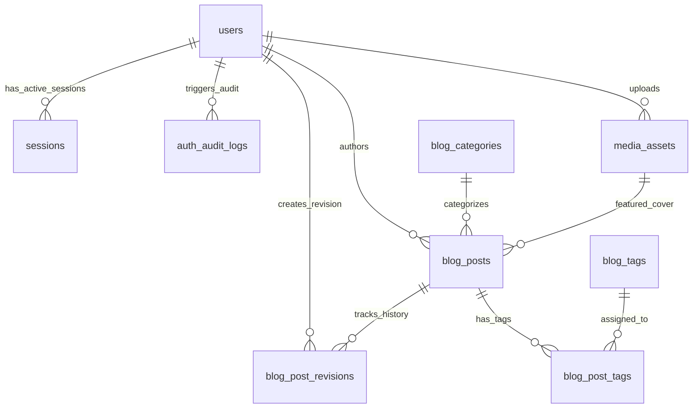

# Database Architecture & Schema Specification — HIMA IF CMS

| Field | Detail |
|---|---|
| **System** | HIMA IF CMS (Modern WordPress-like Blog Engine) |
| **Document Version** | 3.0.0 |
| **Date** | 2026-10-23 |
| **Engine** | PostgreSQL 16+ |
| **Access Model** | SQLAlchemy 2.0 (Async) + Alembic Migrations |
| **Key Convention** | RFC 4122 UUIDv4 Primary Keys (`gen_random_uuid()`) di seluruh tabel entitas |

---

## Riwayat Revisi (Revision History)

| Versi | Tanggal | Penulis / Reviewer | Bagian yang Diubah | Rincian Perubahan (Sebelum vs Sesudah) | Alasan Perubahan |
|---|---|---|---|---|---|
| 1.0.0 | 2026-10-13 | Staff Ahli Divisi MIK | Dokumen Baru | Baseline perancangan skema database awal. | Inisiasi arsitektur database. |
| 2.0.0 | 2026-10-14 | Staff Ahli MIK & Auditor | Evaluasi & Enkripsi | Penambahan relasi interview per baris, enkripsi AES-256 PIN pelamar, CHECK constraints. | Hardening keamanan modul wawancara. |
| 2.1.0 | 2026-10-14 | Staff Ahli MIK & Auditor | Migrasi Alembic | Penetapan 3 revisi logis Alembic untuk 18 tabel. | Pembagian migrasi database Fase 1. |
| 2.2.0 | 2026-10-14 | Staff Ahli MIK & Auditor | Konsistensi Tabel | Koreksi enum audit log, penambahan accepted_division_id, active_days uppercase. | Eliminasi desinkronisasi nama kolom & audit. |
| 3.0.0 | 2026-10-23 | Staff Ahli MIK & Antigravity Lead | Seluruh Dokumen | **Sebelum:** 18 tabel kompleks mencakup formulir dinamis & interview booking.<br>**Sesudah:** 7 tabel murni Blog CMS (`users`, `sessions`, `auth_audit_logs`, `blog_categories`, `blog_tags`, `blog_post_tags`, `blog_posts`, `blog_post_revisions`, `media_assets`), migrasi TipTap AST JSONB (`content_json`) & sanitized HTML (`content_html`), migrasi Alembic dirampingkan menjadi 2 tahap. | Pivot organisasi: eliminasi modul interview & form, memusatkan sistem sebagai engine blogging modern sekelas WordPress. |

---

## 1. Table Summary

Skema database dirancang murni untuk mendukung performa tinggi, modularitas, dan keamanan portal publikasi berita serta blog organisasi. Skema dieksekusi melalui **2 revisi migrasi Alembic logis terurut**:
1. **`001_auth_and_sessions.py`**: Modul Keamanan, Pengguna, dan Audit (`users`, `sessions`, `auth_audit_logs`).
2. **`002_blog_cms_and_media.py`**: Modul Blog, Taksonomi, dan Media Storage (`blog_categories`, `blog_tags`, `blog_post_tags`, `media_assets`, `blog_posts`, `blog_post_revisions`).

| No | Nama Tabel | Modul | Tanggung Jawab Utama | Jumlah Kolom |
|---|---|---|---|:---:|
| 1 | `users` | Auth & Akun | Data akun admin dan penulis (Argon2id password hash, role RBAC, auth_epoch) | 12 |
| 2 | `sessions` | Auth & Sesi | Tracking sesi aktif berbasis session ID (HttpOnly Cookie), user-agent, dan IP | 7 |
| 3 | `auth_audit_logs` | Audit & Security | Rekaman jejak audit autentikasi, rotasi password, dan perubahan hak akses | 8 |
| 4 | `blog_categories` | Blog Taksonomi | Pengelompokan artikel, slug unik, deskripsi, dan warna visual badge | 7 |
| 5 | `blog_tags` | Blog Taksonomi | Label tag granular untuk navigasi artikel dan metadata SEO | 5 |
| 6 | `blog_post_tags` | Blog Taksonomi | Tabel relasi *many-to-many* antara artikel blog dan tag | 3 |
| 7 | `media_assets` | Media & Storage | Metadata aset gambar Cloudflare R2 (WebP), dimensi, resolusi, dan alt text | 11 |
| 8 | `blog_posts` | Blog Core | Entitas utama artikel, ProseMirror AST JSONB, sanitized HTML, SEO, dan jadwal tayang | 17 |
| 9 | `blog_post_revisions`| Blog Versioning | Snapshot riwayat perubahan artikel untuk audit, perbandingan diff, dan rollback | 7 |

---

## 2. Entity Relationship Diagram (ERD)



---

## 3. Spesifikasi Rinci Tabel

### 3.1 Modul Auth, Pengguna & Sesi

#### Tabel 1: `users`
Menyimpan identitas terverifikasi pengurus HIMA IF (Super Admin dan Author).

```sql
CREATE TYPE user_role_enum AS ENUM ('SUPER_ADMIN', 'AUTHOR');

CREATE TABLE users (
    id UUID PRIMARY KEY DEFAULT gen_random_uuid(),
    email VARCHAR(255) NOT NULL UNIQUE,
    username VARCHAR(50) NOT NULL UNIQUE,
    password_hash VARCHAR(255) NOT NULL,
    full_name VARCHAR(100) NOT NULL,
    avatar_url VARCHAR(500),
    role user_role_enum NOT NULL DEFAULT 'AUTHOR',
    must_change_password BOOLEAN NOT NULL DEFAULT FALSE,
    is_active BOOLEAN NOT NULL DEFAULT TRUE,
    auth_epoch INTEGER NOT NULL DEFAULT 1,
    created_at TIMESTAMPTZ NOT NULL DEFAULT NOW(),
    updated_at TIMESTAMPTZ NOT NULL DEFAULT NOW()
);

CREATE INDEX idx_users_email ON users(email);
CREATE INDEX idx_users_username ON users(username);
CREATE INDEX idx_users_role_active ON users(role, is_active);
```

#### Tabel 2: `sessions`
Menyimpan ID sesi server-side yang terhubung dengan HttpOnly Cookie (`__Host-himaif_session`). Memungkinkan pencabutan sesi instan (*instant session revocation*) tanpa membebani database utama berkat in-memory caching di Redis.

```sql
CREATE TABLE sessions (
    id VARCHAR(64) PRIMARY KEY, -- Token acak 256-bit (hex-encoded)
    user_id UUID NOT NULL REFERENCES users(id) ON DELETE CASCADE,
    user_agent VARCHAR(500),
    ip_address VARCHAR(45) NOT NULL, -- IPv4 atau IPv6
    expires_at TIMESTAMPTZ NOT NULL,
    created_at TIMESTAMPTZ NOT NULL DEFAULT NOW(),
    last_active_at TIMESTAMPTZ NOT NULL DEFAULT NOW()
);

CREATE INDEX idx_sessions_user_id ON sessions(user_id);
CREATE INDEX idx_sessions_expires_at ON sessions(expires_at);
```

#### Tabel 3: `auth_audit_logs`
Merekam seluruh aktivitas kritikal autentikasi dan otorisasi.

```sql
CREATE TYPE auth_event_enum AS ENUM (
    'LOGIN_SUCCESS',
    'LOGIN_FAILED',
    'LOGOUT',
    'PASSWORD_CHANGE',
    'PASSWORD_RESET',
    'ROLE_CHANGE',
    'ACCOUNT_DISABLED',
    'SESSION_REVOKED',
    'AUTH_TOKEN_REUSE_DETECTED'
);

CREATE TABLE auth_audit_logs (
    id UUID PRIMARY KEY DEFAULT gen_random_uuid(),
    user_id UUID REFERENCES users(id) ON DELETE SET NULL,
    event auth_event_enum NOT NULL,
    ip_address VARCHAR(45) NOT NULL,
    user_agent VARCHAR(500),
    metadata JSONB NOT NULL DEFAULT '{}'::jsonb,
    created_at TIMESTAMPTZ NOT NULL DEFAULT NOW()
);

CREATE INDEX idx_auth_audit_user_event ON auth_audit_logs(user_id, event);
CREATE INDEX idx_auth_audit_created ON auth_audit_logs(created_at DESC);
```

---

### 3.2 Modul Taksonomi & Media Asset

#### Tabel 4: `blog_categories`
Kategori hierarkis utama untuk pengelompokan berita dan opini.

```sql
CREATE TABLE blog_categories (
    id UUID PRIMARY KEY DEFAULT gen_random_uuid(),
    name VARCHAR(100) NOT NULL UNIQUE,
    slug VARCHAR(120) NOT NULL UNIQUE,
    description TEXT,
    color_hex VARCHAR(7) NOT NULL DEFAULT '#1E40AF', -- Hex color untuk badge UI
    post_count INTEGER NOT NULL DEFAULT 0,
    created_at TIMESTAMPTZ NOT NULL DEFAULT NOW(),
    updated_at TIMESTAMPTZ NOT NULL DEFAULT NOW()
);

CREATE UNIQUE INDEX idx_categories_slug ON blog_categories(slug);
```

#### Tabel 5: `blog_tags` & Tabel 6: `blog_post_tags`
Tag granular untuk indeks pencarian dan penjelajahan topik artikel.

```sql
CREATE TABLE blog_tags (
    id UUID PRIMARY KEY DEFAULT gen_random_uuid(),
    name VARCHAR(50) NOT NULL UNIQUE,
    slug VARCHAR(60) NOT NULL UNIQUE,
    post_count INTEGER NOT NULL DEFAULT 0,
    created_at TIMESTAMPTZ NOT NULL DEFAULT NOW()
);

CREATE UNIQUE INDEX idx_tags_slug ON blog_tags(slug);

CREATE TABLE blog_post_tags (
    post_id UUID NOT NULL REFERENCES blog_posts(id) ON DELETE CASCADE,
    tag_id UUID NOT NULL REFERENCES blog_tags(id) ON DELETE CASCADE,
    created_at TIMESTAMPTZ NOT NULL DEFAULT NOW(),
    PRIMARY KEY (post_id, tag_id)
);

CREATE INDEX idx_post_tags_tag_id ON blog_post_tags(tag_id);
```

#### Tabel 7: `media_assets`
Katalog berkas gambar yang diunggah ke Cloudflare R2 (format WebP teroptimasi).

```sql
CREATE TABLE media_assets (
    id UUID PRIMARY KEY DEFAULT gen_random_uuid(),
    file_name VARCHAR(255) NOT NULL,       -- UUIDv4.webp
    original_name VARCHAR(255) NOT NULL,   -- Nama asli dari laptop penulis
    storage_path VARCHAR(500) NOT NULL,    -- Path di R2: uploads/2026/10/uuid.webp
    mime_type VARCHAR(100) NOT NULL,       -- image/webp, image/jpeg, image/png
    file_size_bytes INTEGER NOT NULL,      -- Batas maks: 5 MB
    width INTEGER,                         -- Dimensi piksel (maks 4096 px)
    height INTEGER,                        -- Dimensi piksel (maks 4096 px)
    alt_text VARCHAR(255) NOT NULL DEFAULT '',
    uploaded_by UUID REFERENCES users(id) ON DELETE SET NULL,
    created_at TIMESTAMPTZ NOT NULL DEFAULT NOW()
);

CREATE INDEX idx_media_uploaded_by ON media_assets(uploaded_by);
CREATE INDEX idx_media_created_at ON media_assets(created_at DESC);
```

---

### 3.3 Modul Inti Artikel Blog

#### Tabel 8: `blog_posts`
Tabel utama penyimpan artikel. Menggabungkan **AST JSONB** (struktur data kanonik ProseMirror dari TipTap Editor yang aman dari script injection) dan **Sanitized HTML** (hasil kompilasi terfilter oleh Rust `nh3` untuk SSR cepat tanpa overhead parsing).

```sql
CREATE TYPE post_status_enum AS ENUM ('DRAFT', 'SCHEDULED', 'PUBLISHED', 'ARCHIVED');

CREATE TABLE blog_posts (
    id UUID PRIMARY KEY DEFAULT gen_random_uuid(),
    title VARCHAR(255) NOT NULL,
    slug VARCHAR(280) NOT NULL UNIQUE,
    excerpt TEXT NOT NULL DEFAULT '',
    
    -- Struktur Konten Ganda (Aman & Berkinerja Tinggi)
    content_json JSONB NOT NULL DEFAULT '{}'::jsonb, -- TipTap ProseMirror AST Kanonik
    content_html TEXT NOT NULL DEFAULT '',           -- Clean HTML terkompilasi (via nh3)
    
    featured_image_id UUID REFERENCES media_assets(id) ON DELETE SET NULL,
    author_id UUID NOT NULL REFERENCES users(id) ON DELETE RESTRICT,
    category_id UUID NOT NULL REFERENCES blog_categories(id) ON DELETE RESTRICT,
    
    status post_status_enum NOT NULL DEFAULT 'DRAFT',
    published_at TIMESTAMPTZ,
    
    -- Metadata SEO & Engagement
    meta_title VARCHAR(255),
    meta_description VARCHAR(320),
    reading_time_minutes INTEGER NOT NULL DEFAULT 1,
    view_count BIGINT NOT NULL DEFAULT 0,
    
    created_at TIMESTAMPTZ NOT NULL DEFAULT NOW(),
    updated_at TIMESTAMPTZ NOT NULL DEFAULT NOW(),
    
    -- Constraint Logika Bisnis
    CONSTRAINT chk_scheduled_published_at CHECK (
        (status != 'SCHEDULED') OR (status = 'SCHEDULED' AND published_at IS NOT NULL)
    )
);

-- Indeks Kueri Publik & SEO
CREATE UNIQUE INDEX idx_blog_posts_slug ON blog_posts(slug);
CREATE INDEX idx_blog_posts_public_feed ON blog_posts(status, published_at DESC);
CREATE INDEX idx_blog_posts_author ON blog_posts(author_id);
CREATE INDEX idx_blog_posts_category ON blog_posts(category_id);
CREATE INDEX idx_blog_posts_created_at ON blog_posts(created_at DESC);

-- GIN Index untuk pencarian teks penuh (Full-Text Search)
CREATE INDEX idx_blog_posts_search ON blog_posts USING gin(
    to_tsvector('indonesian', coalesce(title, '') || ' ' || coalesce(excerpt, ''))
);
```

#### Tabel 9: `blog_post_revisions`
Mencatat setiap kali artikel disimpan atau diperbarui. Memungkinkan Super Admin atau Author melihat riwayat editan, komparasi visual, serta memulihkan (*rollback*) konten jika terjadi kesalahan editorial.

```sql
CREATE TABLE blog_post_revisions (
    id UUID PRIMARY KEY DEFAULT gen_random_uuid(),
    post_id UUID NOT NULL REFERENCES blog_posts(id) ON DELETE CASCADE,
    author_id UUID REFERENCES users(id) ON DELETE SET NULL,
    title VARCHAR(255) NOT NULL,
    content_json JSONB NOT NULL,
    revision_number INTEGER NOT NULL,
    change_summary VARCHAR(255) DEFAULT '',
    created_at TIMESTAMPTZ NOT NULL DEFAULT NOW(),
    
    CONSTRAINT uq_post_revision_number UNIQUE (post_id, revision_number)
);

CREATE INDEX idx_revisions_post_id ON blog_post_revisions(post_id, revision_number DESC);
```

---

## 4. Alur Penjadwalan Tayang Tanpa Background Worker (Celery-Free)

Untuk menjamin reliabilitas dan menyederhanakan arsitektur (meniadakan kebutuhan Celery Worker + Beat), status publikasi artikel didukung oleh kueri cerdas:

1. Penulis menjadwalkan artikel:
   `status = 'SCHEDULED'`, `published_at = '2026-10-25 08:00:00+07'`.
2. Kueri portal publik:
   ```sql
   SELECT * FROM blog_posts
   WHERE status = 'PUBLISHED' 
      OR (status = 'SCHEDULED' AND published_at <= NOW())
   ORDER BY published_at DESC
   LIMIT 10;
   ```
3. Begitu waktu jam tayang tercapai, artikel otomatis tampil di portal publik seketika. Opsional: Cron job ringan harian menjalankan mutasi status dari `SCHEDULED` menjadi `PUBLISHED`:
   ```sql
   UPDATE blog_posts 
   SET status = 'PUBLISHED' 
   WHERE status = 'SCHEDULED' AND published_at <= NOW();
   ```

---

## 5. Rencana Migrasi Database Alembic

Pembaruan skema dieksekusi dalam 2 file migrasi Alembic murni:
- **`versions/001_auth_and_sessions.py`**:
  Membuat tipe ENUM `user_role_enum`, `auth_event_enum`, serta tabel `users`, `sessions`, dan `auth_audit_logs`.
- **`versions/002_blog_cms_and_media.py`**:
  Membuat tipe ENUM `post_status_enum`, serta tabel `blog_categories`, `blog_tags`, `media_assets`, `blog_posts`, `blog_post_tags`, dan `blog_post_revisions`.

Skema ini 100% agnostik terhadap lingkungan server dan siap dideploy baik di VPS Hostinger maupun VPS Kampus Telkom University.
