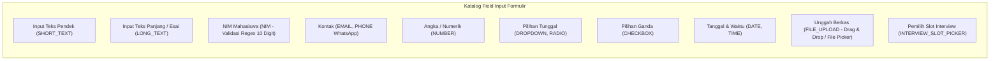
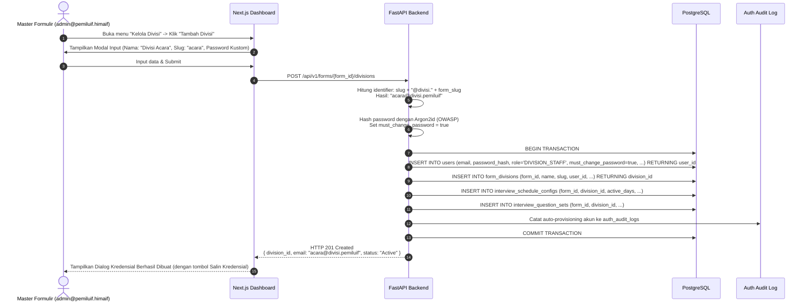
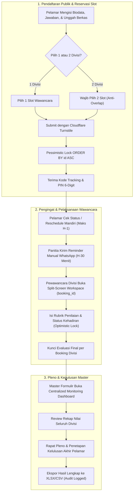

# Modul Formulir Dinamis & Manajemen Wawancara — HIMA IF CMS

| Field | Detail |
|---|---|
| **System** | HIMA IF CMS |
| **Document Version** | 2.0.0 |
| **Date** | 14 October 2026 |
| **Status** | Approved Specification |
| **Form Builder Engine** | Dynamic JSON Schema Form Generator |
| **Concurrency Control** | Global Anti-Deadlock Locking (`SELECT ... FOR UPDATE` with `ORDER BY id ASC`) + Optimistic Locking (`version`) |
| **Evaluation Model** | Granular Per-Booking Evaluation (`interview_bookings`) + Redis Advisory Lock |

---

## Riwayat Revisi (Revision History)

| Versi | Tanggal | Penulis | Ringkasan Perubahan | Alasan |
|---|---|---|---|---|
| 1.0.0 | 13 Oktober 2026 | Staff Ahli Divisi MIK (Proker Informasite) | Draf awal spesifikasi modul form dinamis dan interview. | Inisiasi baseline modul formulir dan wawancara. |
| 2.0.0 | 14 Oktober 2026 | Staff Ahli Divisi MIK & Antigravity Auditor | Penambahan urutan penguncian global anti-deadlock multi-slot, aturan wajib booking 2 slot untuk 2 divisi, reschedule mandiri publik (batas H-1 + Turnstile), integrasi Redis advisory lock dengan script Lua atomik pada workspace evaluasi, peleburan evaluasi ke baris `interview_bookings`, dan penegasan prosedur operasional pengingat manual WhatsApp H-30 menit. | Penyesuaian arsitektur database v2.0.0 dan pencegahan deadlock / tabrakan konkurensi. |

---

## 1. Dynamic Form Builder Engine

Modul Form Builder memungkinkan Master Formulir (`admin@namakepanitiaan.himaif`) dan Super Admin untuk merancang formulir pendaftaran acara atau *Open Recruitment (Oprec)* tanpa batas jumlah field.

### 1.1 Tipe Input Custom yang Didukung



### 1.2 Format Definisi Field & Validasi JSONB
Setiap field disimpan pada tabel `form_fields` dengan konfigurasi fleksibel:

```json
{
  "field_name": "link_portofolio",
  "field_label": "Tautan Portofolio / GitHub",
  "field_type": "SHORT_TEXT",
  "placeholder": "https://github.com/username atau drive link",
  "is_required": true,
  "order_index": 4,
  "validation_rules": {
    "min_length": 5,
    "max_length": 255,
    "regex": "^(https?:\\/\\/)?([\\da-z\\.-]+)\\.([a-z\\.]{2,6})([\\/\\w \\.-]*)*\\/?$"
  },
  "conditional_rules": {
    "show_if": {
      "field": "primary_division_id",
      "operator": "IN",
      "values": ["uuid-divisi-medkraf", "uuid-divisi-webdev"]
    }
  }
}
```

### 1.3 Komponen Upload Berkas (Drag & Drop + Security)
- **UI/UX**: Menggunakan komponen custom berbasis `react-dropzone` dan Tailwind CSS di shadcn/ui. Mendukung drag-and-drop, visual upload progress bar, dan file thumbnail preview.
- **Batasan Unggah**:
  - Batas ukuran file per berkas: Maksimal 5 MB hingga 10 MB (dikonfigurasi per field).
  - Pembatasan ekstensi & MIME: Dokumen (PDF only) atau Gambar (JPG, PNG).
  - Keamanan Server: Backend FastAPI memeriksa *magic bytes* file untuk mencegah eksekusi skrip terselubung (.php/.exe dengan ekstensi .pdf).
  - Seluruh file pendaftar disimpan pada bucket private vault (*S3-compatible object storage*) dengan proteksi akses URL bertenggat (*presigned URL*).

---

## 2. Divisi Custom & Auto-Provisioning Akun Divisi

Setiap formulir kepanitiaan memiliki struktur divisi yang berbeda-beda (cth: Acara, Humas, Medkraf, Logistik, Sponsorship). Master Formulir dapat menambahkan divisi custom secara mandiri.



---

## 3. Penjadwalan Wawancara per Divisi & Concurrency Control

### 3.1 Penentuan Blok Jadwal & Durasi Sesi
Master Formulir dan Akun Divisi dapat mengatur parameter jadwal:
- **Rentang Tanggal**: cth. 15 Oktober 2026 s.d. 18 Oktober 2026.
- **Hari Aktif Operasional (`active_days`)**: Array JSONB (misal: `["MONDAY", "TUESDAY", "WEDNESDAY", "THURSDAY", "FRIDAY"]`) untuk mengabaikan akhir pekan secara otomatis.
- **Blok Jam Operasional Harian**: cth. Jam 09:00 s.d. 17:00 WIB.
- **Durasi per Sesi**: cth. 30 menit (fleksibel: 15, 30, 45, 60 menit).
- **Jeda Antar Sesi (Buffer)**: cth. 5 menit untuk transisi kandidat.
- **Kapasitas Kursi per Slot**: Default 1 orang per slot (`capacity`), diverifikasi oleh database constraint `CONSTRAINT chk_slot_capacity CHECK (booked_count >= 0 AND booked_count <= capacity)`.

**Algoritma Generator Slot Waktu Otomatis**:
Sistem menghitung pembagian slot harian dan memasukkan entri diskrit ke tabel `interview_slots`:
$$\text{Jumlah Slot per Hari} = \left\lfloor \frac{\text{Jam Selesai} - \text{Jam Mulai}}{\text{Durasi Sesi} + \text{Buffer}} \right\rfloor$$
*Contoh*: 09:00 - 17:00 (480 menit), durasi 30 menit + buffer 5 menit = 13 slot per hari.

### 3.2 Fitur Blokir Slot oleh Divisi (Slot Blocking)
Setiap akun divisi memiliki kendali atas jadwal wawancaranya sendiri:
- Divisi dapat membuka kalender jadwal dan mengklik tombol **"Blokir Slot"** pada jam tertentu (misal: ishoma, atau jadwal kuliah pewawancara).
- Kolom `is_blocked = true` dan `block_reason = "Jadwal Kuliah"` diperbarui.
- Slot yang diblokir otomatis disembunyikan dari pilihan mahasiswa pendaftar di portal publik.
- *Aturan Slot Terisi:* Jika slot sudah berisi booking pelamar aktif, penonaktifan slot tidak diizinkan sebelum panitia memindahkan booking pendaftar tersebut ke slot lain terlebih dahulu.

### 3.3 Aturan Pemilihan Slot: Pendaftar Multi-Divisi
Jika pelamar memilih 2 divisi (`primary_division_id` dan `secondary_division_id`):
1. Pelamar **wajib memesan dua slot wawancara yang terpisah**, masing-masing untuk Divisi 1 dan Divisi 2.
2. Kedua slot harus berasal dari jadwal divisi masing-masing.
3. Rentang waktu kedua slot **tidak boleh tumpang tindih (*anti-overlap*)**. Sistem memvalidasi bahwa `slot1.end_time <= slot2.start_time` atau `slot2.end_time <= slot1.start_time`.
4. Sistem mencatat dua baris terpisah pada tabel `interview_bookings` dengan relasi `submission_id` yang sama dan `division_id` yang sesuai, dilindungi constraint unik `(submission_id, division_id)`.

### 3.4 Urutan Penguncian Global Anti-Deadlock (Pessimistic Locking)
Untuk mencegah *circular wait deadlock* saat ratusan pelamar mendaftar atau melakukan reschedule bersamaan pada kombinasi slot yang saling bersilangan:

```sql
-- Transaksi atomik pemesanan slot multi-divisi
BEGIN;

-- 1. Mengunci slot secara global berurutan berdasarkan Primary Key (id ASC)
SELECT id, capacity, booked_count, is_blocked, start_time, end_time, division_id
FROM interview_slots 
WHERE id IN (:primary_slot_id, :secondary_slot_id)
ORDER BY id ASC 
FOR UPDATE;

-- 2. Validasi atomik setelah seluruh baris terkunci:
--    a. Pastikan kedua slot is_blocked = FALSE.
--    b. Pastikan booked_count < capacity untuk setiap slot.
--    c. Pastikan division_id slot sesuai dengan pilihan divisi pelamar.
--    d. Pastikan rentang waktu kedua slot tidak overlap.

-- 3. Inkrementasi booked_count
UPDATE interview_slots 
SET booked_count = booked_count + 1 
WHERE id IN (:primary_slot_id, :secondary_slot_id);

-- 4. Simpan booking ke basis data
INSERT INTO interview_bookings (id, slot_id, submission_id, division_id, status, version)
VALUES 
  (gen_random_uuid(), :primary_slot_id, :submission_id, :primary_division_id, 'CONFIRMED', 1),
  (gen_random_uuid(), :secondary_slot_id, :submission_id, :secondary_division_id, 'CONFIRMED', 1);

COMMIT;
```

---

## 4. Reschedule Wawancara & Operasional Pengingat Jadwal

### 4.1 Aturan Reschedule Mandiri Publik
1. **Batas Waktu (Cut-off H-1)**:
   - Mahasiswa pendaftar dapat melakukan reschedule slot interview secara mandiri melalui portal status publik `/status`.
   - Reschedule **hanya diizinkan jika dilakukan paling lambat 24 jam (H-1)** sebelum waktu mulai sesi interview saat ini (`now() <= current_slot.start_time - INTERVAL '24 hours'`).
   - Slot target baru juga harus berjarak minimal 24 jam dari waktu transaksi saat ini.
2. **Frekuensi & Keamanan**:
   - Reschedule mandiri diizinkan **tanpa batas jumlah kali**, asalkan selalu memenuhi batas waktu H-1 dan slot tujuan masih memiliki kuota kosong.
   - Setiap pengajuan reschedule wajib memvalidasi token **Cloudflare Turnstile** dan kredensial pelamar (`submission_code`, `applicant_nim`, dan `tracking_pin` 6-digit terenkripsi).
   - Dilindungi rate limit ketat per IP dan per NIM di Redis Instance 3.
3. **Mekanisme Locking Reschedule**:
   - Kunci baris `interview_bookings` terlebih dahulu.
   - Kunci slot lama dan slot baru sekaligus menggunakan `SELECT ... FROM interview_slots WHERE id IN (old_slot_id, new_slot_id) ORDER BY id ASC FOR UPDATE`.
   - Kurangi `booked_count` slot lama, tambah `booked_count` slot baru.
   - Perbarui referensi `slot_id` pada `interview_bookings`.
   - Catat peristiwa perubahan jadwal pada `auth_audit_logs` dengan event `RESCHEDULE_INTERVIEW`.

### 4.2 Prosedur Operasional Pengingat Jadwal (WhatsApp Manual H-30 Menit)
Karena sistem HIMA IF CMS dirancang mandiri tanpa dependensi mail server (SMTP):
1. **Pengecekan Mandiri**: Pendaftar wajib secara proaktif memantau status dan jadwal wawancaranya secara berkala melalui portal `/status` dengan memasukkan Kode Pendaftaran, NIM, dan PIN 6-digit.
2. **Pengingat Manual Panitia**:
   - Panitia divisi bertanggung jawab mengingatkan setiap peserta secara manual melalui **WhatsApp pada H-30 menit** sebelum sesi wawancara dimulai.
   - Pesan WhatsApp memuat konfirmasi waktu, nama pewawancara, tautan Google Meet / lokasi ruang fisik wawancara, serta tata tertib sesi.
   - Akun divisi dapat melihat nomor WhatsApp peserta langsung dari panel evaluasi tanpa perlu membuka berkas dokumen lengkap.

---

## 5. Pertanyaan Custom & Workspace Evaluasi Divisi

### 5.1 Pembuat Pertanyaan Custom (Question Builder)
Setiap divisi dapat menentukan butir-butir pertanyaan wawancara sendiri:
- **Jawaban Singkat (SHORT_ANSWER)**: Pengecekan cepat pemahaman teknis/organisasi.
- **Jawaban Panjang / Kasus (LONG_ANSWER)**: Studi kasus dan penalaran kontekstual.
- **Pilihan Ganda (SINGLE_CHOICE / MULTI_CHOICE)**: Menentukan kecocokan sub-bidang.
- **Skala Penilaian / Rubrik (RATING_SCALE)**: Skala 1 - 5 atau 1 - 10 dengan panduan rubrik eksplisit dan pembobotan skor (persentase).

### 5.2 Workspace Wawancara Terintegrasi (Split-Screen Workspace)
Saat sesi interview berlangsung, pewawancara membuka halaman `/admin/interviews/[id]/workspace` berbasis parameter `{booking_id}`:

```
┌─────────────────────────────────────────┬─────────────────────────────────────────┐
│ PANEL KIRI: PROFIL & BERKAS PELAMAR     │ PANEL KANAN: LEMBAR PENILAIAN LIVE      │
├─────────────────────────────────────────┼─────────────────────────────────────────┤
│ • Nama: Muhammad Fadhil                 │ • Pewawancara Aktif: acara@divisi...    │
│ • NIM: 1301220001 (Informatika 2022)    │ • Status: ATTENDED (Hadir)              │
│ • Pilihan 1: Divisi Acara (Booking Ini) │ ─────────────────────────────────────── │
│ • Pilihan 2: Divisi Humas               │ • Pertanyaan 1: Motivasi & Komitmen     │
│ • Kontak WA: 081234567890               │   [Skala 1 - 5]: (● 4)                  │
│                                         │   Catatan: "Sangat antusias, siap lembur"│
│ [ Embedded PDF Viewer: Curiculum Vitae ]│ • Pertanyaan 2: Solusi Masalah Rundown  │
│ • Jawaban Form Acara:                   │   [Skala 1 - 5]: (● 5)                  │
│   "Pernah menjadi panitia makrab..."    │ • Nilai Otomatis: 90 / 100              │
│                                         │ • Kelebihan: "Public speaking baik"     │
│                                         │ • Rekomendasi: [ DITERIMA ]             │
│                                         │ [ Simpan Draft ]  [ Kunci Nilai Final ] │
└─────────────────────────────────────────┴─────────────────────────────────────────┘
```

### 5.3 Concurrency Control Workspace (Redis Advisory Lock & Optimistic Versioning)
Untuk mencegah tabrakan ketika dua staf divisi membuka dan menilai lembar wawancara kandidat yang sama:
1. **Redis Advisory Lock & Heartbeat**:
   - Saat workspace dibuka, klien mengakuisisi kunci di Redis Instance 3: `SET interview:lock:{booking_id} {user_id} NX EX 60`.
   - Browser mengirim sinyal *heartbeat* setiap 30 detik untuk memperpanjang kunci secara atomik menggunakan script Lua:
     ```lua
     if redis.call("get", KEYS[1]) == ARGV[1] then
         return redis.call("expire", KEYS[1], ARGV[2])
     else
         return 0
     end
     ```
   - Pelepasan kunci saat berpindah halaman atau logout dilakukan dengan aman:
     ```lua
     if redis.call("get", KEYS[1]) == ARGV[1] then
         return redis.call("del", KEYS[1])
     else
         return 0
     end
     ```
   - Jika kunci telah dipegang oleh staf lain, antarmuka menampilkan penanda visual (*banner*) bahwa lembar sedang disunting oleh pengguna lain.
2. **Database Optimistic Locking (`version`)**:
   - Kolom `version` pada tabel `interview_bookings` dinaikkan setiap kali draft atau nilai final disimpan:
     ```sql
     UPDATE interview_bookings 
     SET score = :score, attendance_status = :status, notes = :notes, version = version + 1
     WHERE id = :booking_id AND version = :current_version;
     ```
   - Jika `ROWCOUNT = 0`, server mengembalikan HTTP 409 `RESOURCE_CONFLICT`, mencegah penimpaan data tanpa sengaja.

---

## 6. Alur End-to-End Pendaftaran sampai Keputusan Final


