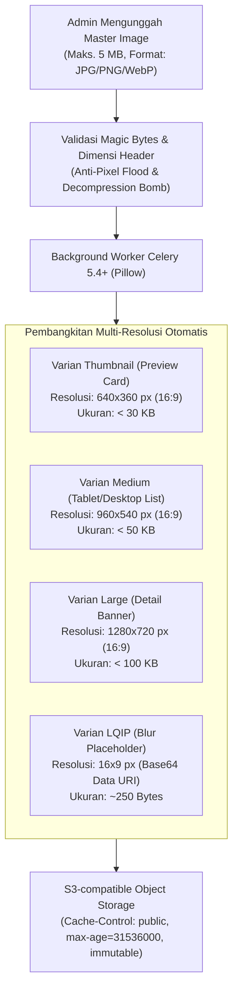
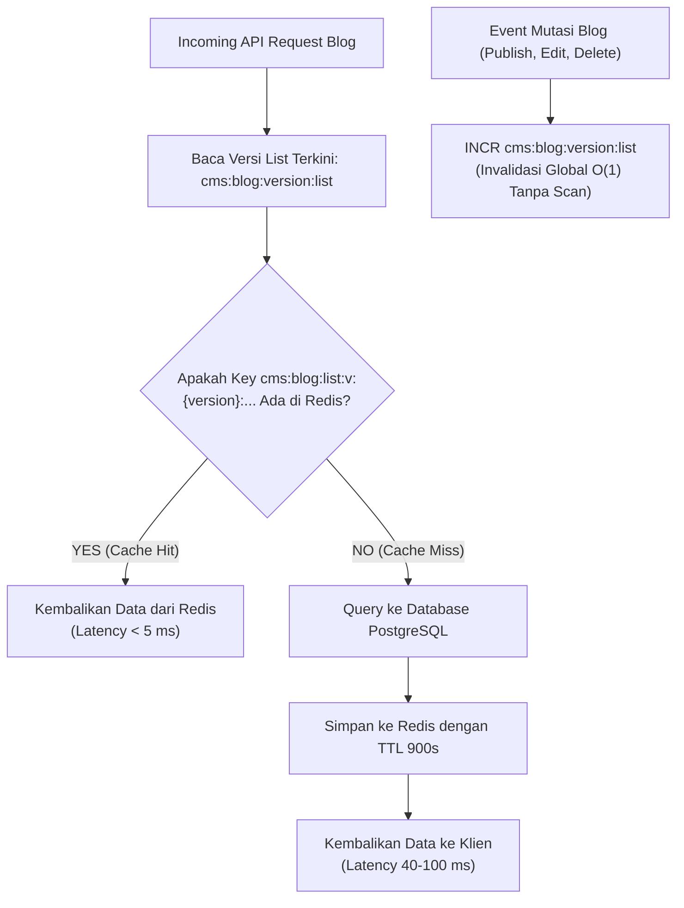

# Strategi Optimasi Gambar & Performa Sistem — HIMA IF CMS

| Field | Detail |
|---|---|
| **System** | HIMA IF CMS |
| **Document Version** | 1.1.0 |
| **Date** | 14 October 2026 |
| **Status** | Approved Specification |
| **Target Core Web Vitals** | LCP < 1.5 detik, INP < 100 ms, CLS = 0.000 |
| **Image Compression Engine** | Python Pillow (PIL) + Celery 5.4+ Asynchronous Worker |
| **Storage Engine** | S3-compatible object storage *(Produk: BELUM DIPUTUSKAN)* |
| **Caching Layer** | Redis 7+ Cache-Aside (Version Tag Invalidation $O(1)$) |

---

## Riwayat Revisi (Revision History)

| Versi | Tanggal | Penulis | Ringkasan Perubahan | Alasan |
|---|---|---|---|---|
| 1.0.0 | 13 Oktober 2026 | Staff Ahli Divisi MIK (Proker Informasite) | Draf awal spesifikasi optimasi gambar dan performa. | Inisiasi baseline performa frontend & backend. |
| 1.1.0 | 14 Oktober 2026 | Staff Ahli Divisi MIK & Antigravity Auditor | Standardisasi engine kompresi ke Python Pillow (menghapus Libvips), penambahan proteksi anti-decompression bomb & pixel flood (`Image.MAX_IMAGE_PIXELS = 16_777_216`), adopsi arsitektur storage S3-compatible, migrasi invalidasi cache list ke Version Tag Invalidation $O(1)$ (menghapus scan blocking), dan klarifikasi routing presigned URL dalam topologi satu origin. | Mitigasi risiko DoS pemrosesan gambar dan CPU freeze Redis. |

---

## 1. Standar Dimensi, Rasio & Ketentuan Thumbnail

Untuk memastikan halaman web tetap ringan (*lightweight*) dengan *First Contentful Paint (FCP)* sub-detik, ditetapkan aturan dimensi, rasio aspek, dan target ukuran file gambar:



### 1.1 Tabel Spesifikasi Teknis Thumbnail

| Lokasi Tampil | Rasio Aspek | Tampilan Kontainer (CSS) | Ukuran File Maksimum | Format Output | Atribut Next.js `<Image>` |
|---|:---:|---|:---:|:---:|---|
| **Preview Thumbnail**<br>*(Daftar Blog, Homepage, Card)* | **16:9** | 384 × 216 px (Desktop)<br>320 × 180 px (Mobile) | **< 30 KB** | WebP (Primary)<br>AVIF (Fallback) | `loading="lazy"`<br>`sizes="(max-width: 768px) 100vw, 384px"`<br>`placeholder="blur"` |
| **Thumbnail Asli**<br>*(Header Halaman Detail Blog)* | **16:9** | 1200 × 675 px (Max container) | **< 100 KB** | WebP (Primary)<br>AVIF (Fallback) | `priority={true}`<br>`sizes="(max-width: 1200px) 100vw, 1200px"`<br>`placeholder="blur"` |

---

## 2. Pipeline Kompresi & Pemrosesan Gambar Aman

### 2.1 Proteksi Anti-Decompression Bomb & Pixel Flood
Serangan *decompression bomb* (atau *pixel flood*) terjadi ketika penyerang mengunggah file gambar dengan ukuran kompresi kecil (misal 500 KB gzip/PNG) namun memiliki dimensi piksel raksasa (misal $50000 \times 50000$ piksel). Saat didekompresi ke memori RAM, file tersebut membengkak hingga puluhan gigabyte dan memicu *Out-Of-Memory (OOM) Denial-of-Service*.

**Mitigasi Teknis di Python Pillow:**
1. **Batas Maksimum Piksel**: Ditetapkan secara ketat `Image.MAX_IMAGE_PIXELS = 16_777_216` (16 Megapiksel, setara resolusi $4096 \times 4096$ atau $5120 \times 3200$).
2. **Eskalasi Warning Menjadi Error**: Peringatan dekompresi bom dinaikkan statusnya menjadi exception fatal `DecompressionBombError`.
3. **Pemeriksaan Dimensi Tanpa Dekompresi Bitmap**: Membaca dimensi gambar (`img.size`) langsung dari header biner sebelum memanggil operasi transformasi atau decoding piksel lengkap.
4. **Pembatasan Frame Animasi**: Seluruh gambar thumbnail blog diperlakukan sebagai gambar statis (hanya frame pertama yang diambil jika format mendukung animasi).

```python
# app/services/image_optimizer.py
import io
import base64
import warnings
from PIL import Image, ImageOps, ImageFile

# Mencegah eksekusi partial/corrupted image
ImageFile.LOAD_TRUNCATED_IMAGES = False

# Konfigurasi Anti-Decompression Bomb
Image.MAX_IMAGE_PIXELS = 16_777_216
warnings.simplefilter('error', Image.DecompressionBombWarning)

MAX_DIMENSION = 4096

def validate_image_header(stream: io.BytesIO) -> tuple[int, int]:
    """
    Membaca dimensi dari header tanpa mendekode seluruh bitmap ke RAM.
    """
    stream.seek(0)
    with Image.open(stream) as img:
        width, height = img.size
        if width > MAX_DIMENSION or height > MAX_DIMENSION:
            raise ValueError(f"Dimensi gambar ({width}x{height}) melebihi batas {MAX_DIMENSION}px")
        if (width * height) > Image.MAX_IMAGE_PIXELS:
            raise ValueError("Total piksel gambar melebihi ambang batas keamanan 16MP")
        return width, height

def generate_lqip_base64(image: Image.Image) -> str:
    """Menghasilkan placeholder ultra-kecil untuk Zero Layout Shift"""
    small = image.resize((16, 9), Image.Resampling.LANCZOS)
    small = small.convert("RGB")
    buffer = io.BytesIO()
    small.save(buffer, format="JPEG", quality=30, optimize=True)
    b64 = base64.b64encode(buffer.getvalue()).decode("utf-8")
    return f"data:image/jpeg;base64,{b64}"

def convert_to_webp_variants(image_bytes: bytes):
    stream = io.BytesIO(image_bytes)
    validate_image_header(stream)
    
    stream.seek(0)
    with Image.open(stream) as img:
        # Normalisasi orientasi EXIF
        img = ImageOps.exif_transpose(img)
        # Hapus seluruh metadata EXIF untuk privasi & efisiensi byte
        img_cleaned = Image.new(img.mode, img.size)
        img_cleaned.putdata(list(img.getdata()))
        
        variants = {}
        sizes = {"thumb": (640, 360), "medium": (960, 540), "large": (1280, 720)}
        for name, (w, h) in sizes.items():
            resized = img_cleaned.copy()
            resized.thumbnail((w, h), Image.Resampling.LANCZOS)
            out_buf = io.BytesIO()
            resized.save(out_buf, format="WEBP", quality=82, method=6)
            variants[name] = out_buf.getvalue()
            
        lqip = generate_lqip_base64(img_cleaned)
        return variants, lqip
```

---

## 3. Integrasi Storage & Akses Presigned URL Satu Origin

Aset biner disimpan pada **S3-compatible object storage** *(keputusan produk spesifik: BELUM DIPUTUSKAN, opsi deployment mencakup MinIO mandiri, Cloudflare R2, atau AWS S3)*.

### 3.1 Topologi Satu Origin (`himaif.id`)
Dalam arsitektur *single-origin reverse proxy*, browser pengguna tidak pernah terhubung langsung ke port atau hostname internal object storage:
1. **Aset Publik (Gambar Blog & Thumbnail)**:
   - Disimpan pada bucket publik.
   - Di-proxy oleh Nginx melalui path `/storage/public/...` dengan header caching agresif (`Cache-Control: public, max-age=31536000, immutable`).
2. **Aset Privat Terproteksi (CV & Lampiran Pendaftar)**:
   - Disimpan pada bucket private vault.
   - Endpoint backend `GET /api/v1/media/{id}/download-url` memvalidasi otorisasi RBAC pengakses, mencatat audit log `DOWNLOAD_APPLICANT_CV`, lalu menerbitkan presigned URL bertenggat 5 menit.
   - Presigned URL dikonfigurasi menggunakan hostname publik satu origin (`https://himaif.id/storage/vault/...`) yang diteruskan oleh Nginx ke upstream S3-compatible storage dengan memvalidasi parameter tanda tangan otentikasi query string.

---

## 4. Strategi Caching Komprehensif dengan Redis

Sistem menggunakan pola **Cache-Aside** pada Redis Instance 1 (Dedicated Cache) untuk meminimalkan beban query PostgreSQL.



### 4.1 Invalidation Berbasis Version Tag ($O(1)$)
Penggunaan perintah pencarian berbasis pola seperti `KEYS` atau `SCAN` dengan `DEL` **dihapus sepenuhnya** dari arsitektur karena berpotensi membekukan event loop Redis pada lalu lintas data tinggi (*CPU blocking*).
- Setiap request pembacaan daftar blog menyertakan nomor versi dari Redis key `cms:blog:version:list` (misal versi `4`).
- Kunci cache disimpan dengan format: `cms:blog:list:v:4:cat:{id}:p:{page}`.
- Saat ada artikel baru yang diterbitkan, diperbarui, atau dihapus, backend cukup mengeksekusi satu operasi atomik:
  ```redis
  INCR cms:blog:version:list
  ```
- Dengan menaikkan versi menjadi `5`, seluruh entri cache list versi `4` secara otomatis ditinggalkan (*orphaned*) dan akan dibersihkan oleh kebijakan *TTL expiration* alami Redis tanpa membebani CPU server.

### 4.2 Inventaris Kunci Cache & Waktu Kedaluwarsa (TTL)

| Pola Kunci Cache | Instance Redis | Isi Data | TTL (Time-To-Live) | Strategi Invalidation |
|---|:---:|---|---|---|
| `cms:blog:version:list` | Instance 1 (Cache) | Counter versi global list blog | **Permanen** | Di-`INCR` saat ada mutasi post/kategori |
| `cms:blog:list:v:{ver}:cat:{id}:p:{p}` | Instance 1 (Cache) | Daftar artikel terbit per kategori | **900 detik** (15 Menit) | Terdereferensi otomatis via `INCR` versi |
| `cms:blog:post:{slug}` | Instance 1 (Cache) | Detail artikel lengkap & content blocks | **3600 detik** (1 Jam) | Dihapus eksplisit via `DEL` saat post diupdate |
| `cms:blog:categories` | Instance 1 (Cache) | Daftar kategori aktif & counter | **86400 detik** (24 Jam) | Dihapus eksplisit saat kategori berubah |
| `cms:form:schema:{slug}` | Instance 1 (Cache) | Skema form & daftar custom field | **1800 detik** (30 Menit) | Dihapus saat field/form diperbarui |
| `session:{jti}` | Instance 3 (Session) | Metadata sesi login & status rotasi | **604800 detik** (7 Hari) | Dihapus saat logout atau deteksi replay |
| `ratelimit:{ip}:{endpoint}` | Instance 3 (Session) | Counter pembatas request | **60 detik** (1 Menit) | Kedaluwarsa otomatis per menit |
| `interview:lock:{booking_id}` | Instance 3 (Session) | ID staf pewawancara aktif | **60 detik** | Diperpanjang via Lua heartbeat 30 detik |

---

## 5. Frontend Performance Tuning (Lenis & Framer Motion)

Penggunaan animasi dan *smooth scrolling* di Next.js dioptimalkan agar tidak menurunkan frame rate (target stabil 60 FPS):

### 5.1 Konfigurasi Lenis Smooth Scrolling
Lenis Scroll diintegrasikan secara global pada root layout:
```tsx
// components/providers/SmoothScrollProvider.tsx
"use client";
import { ReactLenis } from "lenis/react";

export function SmoothScrollProvider({ children }: { children: React.ReactNode }) {
  return (
    <ReactLenis
      root
      options={{
        lerp: 0.1,           // Kehalusan interpolasi scroll
        duration: 1.2,       // Durasi perlambatan scroll
        smoothWheel: true,   // Mengaktifkan smooth scroll pada mouse wheel
        wheelMultiplier: 1.0,// Sensitivitas scroll
        touchMultiplier: 2.0,// Responsif pada perangkat layar sentuh
      }}
    >
      {children}
    </ReactLenis>
  );
}
```
*Optimasi Tambahan*:
- Ketika modal dialog formulir pendaftaran atau drawer evaluasi wawancara dibuka, atribut `data-lenis-prevent` otomatis disematkan pada kontainer modal untuk mencegah tabrakan *event bubbling* antara scroll modal dan scroll halaman latar belakang.

### 5.2 Dynamic Imports & Code Splitting
Komponen-komponen dengan bobot bundle besar dipisahkan dari initial bundle JavaScript publik:
- **TipTap Rich Text Editor**: Dimuat secara lazy (`next/dynamic` dengan `{ ssr: false }`) hanya pada halaman admin editor `/admin/blog/editor`. Pengunjung publik tidak pernah mengunduh bundle TipTap (~120 KB gzip).
- **PDF Viewer (React-PDF)**: Dimuat dinamis hanya saat interviewer membuka workspace wawancara.
- **Framer Motion**: Menggunakan konfigurasi `LazyMotion` dan `domAnimation` untuk memangkas ukuran bundle animasi hingga 70%.
