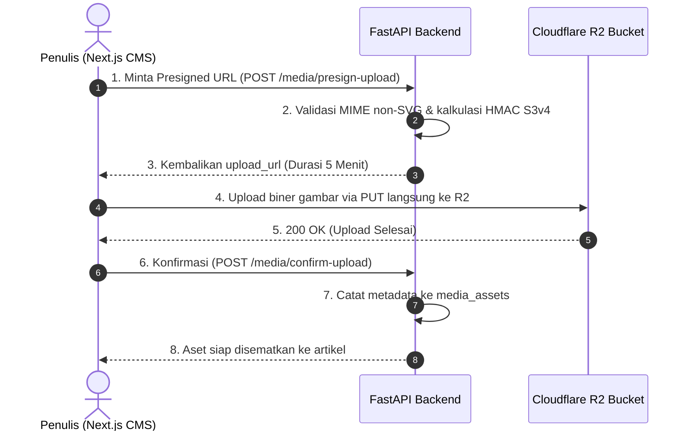

# Strategi Optimasi Gambar & Performa Sistem — HIMA IF CMS

| Field | Detail |
|---|---|
| **System** | HIMA IF CMS (Modern WordPress-like Blog Engine) |
| **Document Version** | 2.0.0 |
| **Date** | 2026-10-23 |
| **Status** | Approved Specification |
| **Target Core Web Vitals** | LCP < 1.5 detik, INP < 100 ms, CLS = 0.000 |
| **Storage Engine** | Cloudflare R2 (S3-Compatible Object Storage, 0 Egress Fee) |
| **Caching Layer** | Nginx Proxy-Cache (5 GB Local SSD VPS) + Redis 7 Cache-Aside |

---

## Riwayat Revisi (Revision History)

| Versi | Tanggal | Penulis / Reviewer | Bagian yang Diubah | Rincian Perubahan (Sebelum vs Sesudah) | Alasan Perubahan |
|---|---|---|---|---|---|
| 1.0.0 | 2026-10-13 | Staff Ahli Divisi MIK | Dokumen Baru | Baseline arsitektur optimasi gambar dan Core Web Vitals awal. | Inisiasi spesifikasi performa frontend & media. |
| 1.1.0 | 14 Oktober 2026 | Staff Ahli MIK & Auditor | Security & Pillow | Standardisasi ke Pillow, proteksi anti-decompression bomb 16 MP, Version Tag Invalidation $O(1)$. | Mitigasi DoS dan pemblokiran CPU Redis. |
| 1.2.0 | 14 Oktober 2026 | Staff Ahli MIK & Auditor | S3 & Presigned URL | Pembakuan MinIO & Cloudflare R2, durasi presigned URL 5 menit, inventaris cache slot. | Penyelarasan arsitektur relasional v2.2.0. |
| 2.0.0 | 2026-10-23 | Staff Ahli MIK & Antigravity Lead | Seluruh Dokumen | **Sebelum:** Background worker Celery + Pillow multi-resolusi, storage MinIO/R2 campuran, dependensi cache slot seleksi.<br>**Sesudah:** Eliminasi Celery worker (adopsi pipeline direct upload via AWS SigV4 Presigned URL ke Cloudflare R2), penerapan Nginx Local Proxy-Cache 5 GB SSD di VPS (Cache HIT < 10ms), pembakuan Kontrak Path Relatif (`/storage/public/{id}.webp`), larangan mutlak berkas `.svg`, dan proteksi dekompresi bom 16 MP. | Penyesuaian pivot WordPress-like Blog CMS, simplifikasi arsitektur bebas Celery, dan jaminan portabilitas server. |

---

## 1. Standar Format, Dimensi & Larangan Berkas SVG

Untuk menjamin portal publikasi berita HIMA IF memuat secara instan (*sub-second First Contentful Paint*) serta kebal dari serangan siber:

### 1.1 Spesifikasi Teknis Gambar

| Tipe Gambar | Resolusi Maksimal | Ukuran Maksimal | Format yang Diizinkan | Atribut Next.js `<Image>` |
|---|:---:|:---:|:---:|---|
| **Thumbnail / Cover Blog** | 1920 × 1080 px (16:9) | **< 300 KB** (target kompresi) | WebP (Utama), JPG, PNG | `priority={true}`<br>`sizes="(max-width: 1200px) 100vw, 1200px"` |
| **Gambar Konten TipTap** | 1600 × 1200 px (Maks 16 MP) | **< 5 MB** (batas upload) | WebP (Utama), JPG, PNG | `loading="lazy"`<br>`sizes="(max-width: 768px) 100vw, 800px"` |
| **Avatar Penulis** | 400 × 400 px (1:1) | **< 100 KB** | WebP, JPG, PNG | `loading="lazy"` |

### 1.2 Larangan Mutlak Berkas SVG (*SVG Stored XSS Ban*)
File dengan ekstensi atau MIME-type `.svg` (`image/svg+xml`) **DILARANG KERAS UNTUK DIUNGGAH OLEH PENULIS**.
- **Alasan Keamanan**: Berkas SVG merupakan dokumen berbasis XML yang dapat disusupi tag `<script>` atau event handler JavaScript (`<svg onload="alert(1)">`). Jika SVG dibuka langsung oleh pembaca di browser, skrip berbahaya tersebut akan dieksekusi di bawah origin website organisasi.
- **Implementasi**: Backend menolak upload SVG baik pada ekstensi nama file, deklarasi MIME, maupun inspeksi signature biner (*magic bytes*).

---

## 2. Pipeline Upload Direct-to-Storage (Zero VPS Egress)

Untuk menghemat CPU, memori, dan bandwidth server VPS kampus:
1. Penulis memilih gambar di dashboard CMS Next.js.
2. Frontend meminta **Presigned URL PUT** ke FastAPI:
   `POST /api/v1/media/presign-upload`
3. Backend memverifikasi otorisasi, ukuran berkas ($\le 5\text{ MB}$), dan whitelist ekstensi (`.webp`, `.jpg`, `.jpeg`, `.png`).
4. Backend menghasilkan Presigned URL AWS Signature V4 berdurasi **5 menit (300 detik)** menggunakan HMAC-SHA256 secara **lokal di memori (Zero Outbound Network Call)**.
5. Browser mengunggah berkas gambar langsung ke bucket Cloudflare R2.
6. Frontend mengirimkan konfirmasi: `POST /api/v1/media/confirm-upload` untuk mencatat metadata ke tabel `media_assets`.



---

## 3. Nginx Single-Origin Proxy-Cache (5 GB Local SSD)

Karena DNS kampus dikelola oleh DTI Telkom University (tidak dapat didelegasikan ke Cloudflare), seluruh gambar publik disajikan melalui origin website resmi:

```
Browser Pembaca Blog
        │
        ▼
GET https://himaif.telkomuniversity.ac.id/storage/public/2026/10/uuid.webp
        │
        ▼
[Nginx Reverse Proxy di VPS Kampus]
        │
        ├─► [Cache HIT] ──► Disajikan instan dari Disk SSD VPS (< 10 ms)
        │
        └─► [Cache MISS] ─► Tarik dari Cloudflare R2 Global Storage
                            Simpan ke SSD Cache (5 GB) & Kirim ke Browser
```

### Konfigurasi Nginx Cache:
```nginx
proxy_cache_path /var/cache/nginx/r2_media levels=1:2 keys_zone=r2_cache:20m max_size=5g inactive=30d use_temp_path=off;

location /storage/public/ {
    proxy_pass https://pub-xxxxxxxxxxxx.r2.dev/;
    proxy_set_header Host pub-xxxxxxxxxxxx.r2.dev;

    proxy_cache r2_cache;
    proxy_cache_valid 200 302 30d;
    proxy_cache_valid 404 1m;
    proxy_cache_use_stale error timeout updating http_500 http_502 http_503 http_504;
    proxy_cache_lock on;

    add_header X-Cache-Status $upstream_cache_status;
    add_header Cache-Control "public, max-age=31536000, immutable";

    proxy_hide_header Set-Cookie;
    proxy_ignore_headers Set-Cookie;
}
```

---

## 4. Proteksi Anti-Decompression Bomb & Pixel Flood

Jika ada pemrosesan gambar di backend (misal pembuatan avatar atau thumbnail cadangan):
1. **Batas Maksimum Piksel**: Ditetapkan secara ketat `Image.MAX_IMAGE_PIXELS = 16_777_216` (16 Megapiksel, setara resolusi $4096 \times 4096$).
2. **Eskalasi Warning Menjadi Error**: Peringatan dekompresi bom dinaikkan statusnya menjadi exception fatal `DecompressionBombError` di Pillow.
3. **Pemeriksaan Dimensi Tanpa Dekompresi Bitmap**: Membaca dimensi gambar (`img.size`) langsung dari header biner sebelum melakukan manipulasi piksel.

```python
# app/core/image_guard.py
from PIL import Image, ImageFile
import warnings

# Eskalasi peringatan ke level exception fatal
warnings.simplefilter('error', Image.DecompressionBombWarning)
Image.MAX_IMAGE_PIXELS = 16_777_216 # Maksimal 16 Megapiksel
ImageFile.LOAD_TRUNCATED_IMAGES = False
```

---

## 5. Strategi Caching Redis & Version Tags ($O(1)$)

Untuk memastikan respons API artikel publik instan (< 20 ms):
1. Respons daftar artikel di-cache di Redis: `cache:posts:list:v{version}` dengan TTL 1 jam.
2. Setiap kali ada artikel baru yang dipublikasikan, diupdate, atau dihapus:
   - Backend cukup menaikkan counter versi global: `INCR cache:posts:version`.
   - Seluruh request berikutnya otomatis membaca cache versi baru secara atomik tanpa memerlukan operasi `KEYS *` atau pattern scanning yang membebani CPU Redis.

Arsitektur performa dan media ini menjamin pemuatan halaman publik yang sangat responsif, hemat sumber daya server, dan aman dari serangan eksploitasi file.
