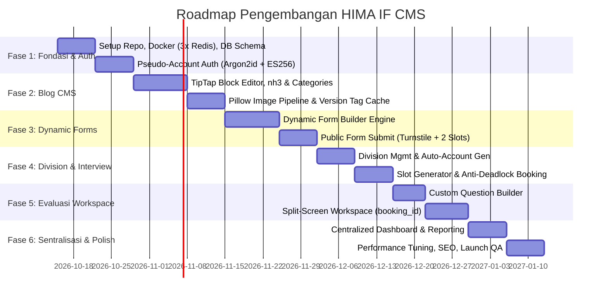
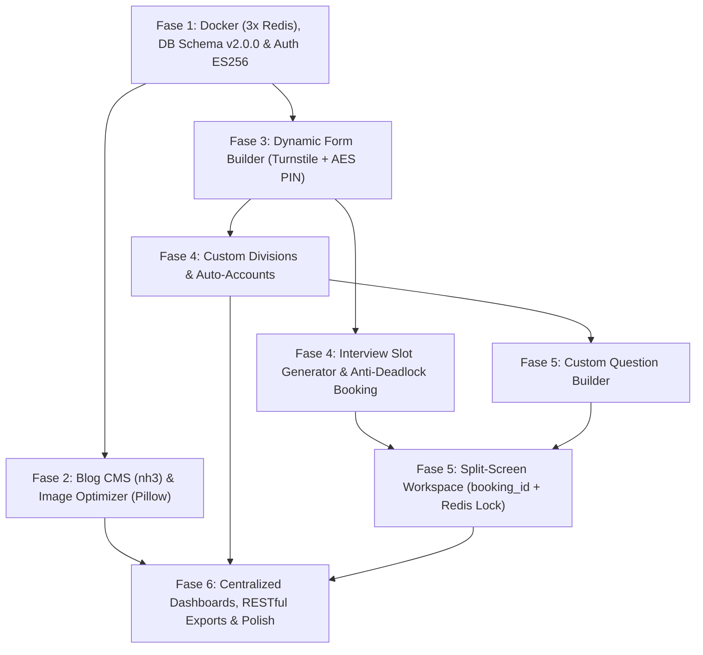

# Rencana Implementasi Bertahap (Implementation Roadmap) — HIMA IF CMS

| Field | Detail |
|---|---|
| **System** | HIMA IF CMS |
| **Document Version** | 1.1.0 |
| **Date** | 14 October 2026 |
| **Status** | Approved Specification |
| **Target Delivery** | 6 Fase Bertahap (Sprint-Based Rollout) |
| **Methodology** | Agile Incremental Implementation + Quality Gates |

---

## Riwayat Revisi (Revision History)

| Versi | Tanggal | Penulis | Ringkasan Perubahan | Alasan |
|---|---|---|---|---|
| 1.0.0 | 13 Oktober 2026 | Staff Ahli Divisi MIK (Proker Informasite) | Draf awal roadmap implementasi bertahap. | Inisiasi perencanaan fase pengembangan. |
| 1.1.0 | 14 Oktober 2026 | Staff Ahli Divisi MIK & Antigravity Auditor | Pembaruan deliverables tiap fase: integrasi 3 instance Redis, ES256 & Argon2id pada Fase 1; pustaka `nh3` & Version Tag Invalidation pada Fase 2; Turnstile & booking multi-slot pada Fase 3; anti-deadlock locking & reschedule H-1 pada Fase 4; evaluasi berbasis `booking_id` & Redis Lua lock pada Fase 5; serta formalisasi ekspor RESTful & audit log pada Fase 6. | Penyelarasan tahapan implementasi dengan hasil audit arsitektur teknis v2.0.0. |

---

## 1. Work Breakdown Structure & Matriks Prioritas

Fitur-fitur sistem dikelompokkan ke dalam tiga tingkat prioritas:
- **P0 (Critical / Blocker)**: Fondasi arsitektur, 3 instance Redis, autentikasi pseudo-email (Argon2id + ES256), skema database v2.0.0, dynamic form builder, Turnstile bot protection, booking multi-slot dengan global anti-deadlock lock ordering, dan blog editor inti dengan sanitasi `nh3`.
- **P1 (Core Feature)**: Auto-provisioning akun divisi (`must_change_password`), live workspace interview berbasis `booking_id` dengan Redis Lua advisory lock, generator varian WebP/AVIF via Pillow, scheduled publishing dengan Version Tag $O(1)$, public reschedule H-1 cut-off, dan ekspor laporan RESTful (tanpa PIN).
- **P2 (Enhancement & Polish)**: Real-time SEO scoring feedback, Lenis smooth scrolling, visual revision diff, cleanup task berkas orphan (24 jam), dan pencarian audit log filter.

---

## 2. Peta Fase Implementasi (6 Fase Bertahap)

---

### Fase 1: Fondasi Arsitektur, Infrastruktur & Autentikasi (Minggu 1 - 2)
**Tujuan**: Menyiapkan containerization, 3 instance Redis terpisah, database PostgreSQL 16, skema tabel relasional v2.0.0, dan autentikasi asimetris ES256 dengan Argon2id.
- **Deliverables**:
  1. Konfigurasi `docker-compose.yml` (PostgreSQL 16, 3x Redis terpisah untuk Cache/Broker/Session, S3-compatible storage, Nginx reverse proxy satu origin).
  2. Inisialisasi skema database via Alembic (`users`, `auth_audit_logs`, `form_submissions`, dll.).
  3. Implementasi backend FastAPI: endpoint `/auth/login` (Argon2id OWASP), `/auth/refresh` (cookie HttpOnly ES256 + reuse detection `jti`), `/auth/change-password`, dan guard `must_change_password`.
  4. Script seeding data awal `app/db/seed.py` (akun `SUPER_ADMIN` dan kategori default).
  5. Inisialisasi frontend Next.js 15 dengan Tailwind CSS, shadcn/ui, `src/middleware.ts` untuk UX routing, dan Zustand auth store murni in-memory.
- **Quality Gate**:
  - Test login sukses dan gagal dengan rate limiting sliding window (lockout setelah 5 kegagalan per 15 menit).
  - Verifikasi token asimetris ES256 sukses di FastAPI dan Next.js.
  - Sesi langsung terputus seketika saat `auth_epoch` dinaikkan atau password diubah.

---

### Fase 2: Modul Media & Blog CMS WordPress-Equivalent (Minggu 3 - 5)
**Tujuan**: Menyediakan platform publikasi artikel berita resmi dengan block editor TipTap, sanitasi modern, dan caching $O(1)$.
- **Deliverables**:
  1. Integrasi **TipTap Rich Text Editor** dengan blok standar dan custom HTML sandboxing.
  2. Implementasi sanitasi ganda (DOMPurify di frontend, `nh3` di backend FastAPI).
  3. Sistem kategori blog (`blog_categories`) dan manajemen URL slug unik.
  4. Pipeline kompresi gambar asinkron via Pillow (`Image.MAX_IMAGE_PIXELS = 16_777_216` anti-decompression bomb) menghasilkan WebP/AVIF dan LQIP base64.
  5. Background worker Celery Beat untuk pengecekan berkala artikel terjadwal dengan **Version Tag Invalidation $O(1)$** (`INCR cms:blog:version:list`).
  6. Sidebar evaluasi SEO real-time dengan feedback lampu indikator (Merah/Oranye/Hijau).
- **Quality Gate**:
  - Artikel terbit tampil di halaman publik dengan LCP < 1.5 detik.
  - Mutasi artikel blog menginvalidasi cache list secara instan tanpa perintah scanning blocking di Redis.

---

### Fase 3: Dynamic Form Builder Engine & Ingestion (Minggu 6 - 7)
**Tujuan**: Membangun form builder fleksibel yang mendukung pendaftaran multi-divisi dan proteksi bot Turnstile.
- **Deliverables**:
  1. Form Builder UI: Susun field custom tanpa batas (NIM, teks, esai, kontak, dropdown, radio).
  2. Komponen upload berkas drag-and-drop dengan validasi magic bytes (PDF dan gambar).
  3. Endpoint publik `/forms/{slug}/submit` dengan verifikasi token Cloudflare Turnstile *fail-closed*.
  4. Aturan pemilihan divisi: jika pelamar memilih 2 divisi, sistem mewajibkan reservasi 2 slot wawancara terpisah yang anti-overlap.
  5. Pembangkitan `submission_code` unik dan `tracking_pin` 6-digit terenkripsi AES-256-GCM / Fernet.
  6. Task Celery Beat `cleanup_tasks.py` untuk menghapus berkas orphan setelah 24 jam.
- **Quality Gate**:
  - Submit massal pendaftar berhasil memvalidasi Turnstile dan menyimpan payload JSONB tanpa data corrupt.
  - Berkas orphan tanpa submission dibersihkan otomatis dalam 24 jam.

---

### Fase 4: Manajemen Divisi & Penjadwalan Wawancara (Minggu 8 - 9)
**Tujuan**: Menghubungkan formulir dengan divisi kepanitiaan dan alokasi waktu wawancara atomik anti-deadlock.
- **Deliverables**:
  1. Fitur tambah divisi custom + auto-provisioning akun login `...@divisi.namakepanitiaan` dengan `must_change_password = true`.
  2. Generator slot interview per divisi dengan dukungan konfigurasi `active_days` (mengabaikan akhir pekan).
  3. Pemblokiran slot (`is_blocked`) oleh akun divisi dengan validasi kepemilikan.
  4. Implementasi transaksi database pemesanan slot multi-divisi menggunakan **Global Anti-Deadlock Locking** (`SELECT ... FROM interview_slots WHERE id IN (...) ORDER BY id ASC FOR UPDATE`).
  5. Fitur reschedule mandiri publik di `/status` dengan batas cut-off H-1 (24 jam) dan Turnstile.
  6. Dokumentasi prosedur operasional pengingat manual WhatsApp H-30 menit oleh panitia.
- **Quality Gate**:
  - Load test k6 / Locust: 100 request concurrent pada slot kapasitas 1 tidak pernah memicu deadlock PostgreSQL dan hanya menghasilkan 1 booking sah (99 request ditolak dengan pesan informatif 409 Conflict).

---

### Fase 5: Instrumen Pertanyaan Custom & Workspace Interview (Minggu 10 - 11)
**Tujuan**: Memberikan fasilitas penilaian terstruktur per booking dengan kontrol konkurensi antar pewawancara.
- **Deliverables**:
  1. Question Builder per divisi: butir pertanyaan fleksibel (esai, pilihan, skala nilai dengan panduan rubrik).
  2. Isolasi data pendaftar: akun divisi dapat mengakses pendaftar yang memilih divisinya sebagai Pilihan 1 atau Pilihan 2.
  3. **Split-Screen Interview Workspace berbasis `{booking_id}`**: profil & CV pendaftar di sisi kiri, lembar input nilai di sisi kanan.
  4. Kontrol konkurensi workspace: Redis Advisory Lock (`interview:lock:{booking_id}`) dengan heartbeat Lua 30s + Database Optimistic Locking (`version` pada `interview_bookings`).
  5. Fitur auto-save draft penilaian dan tombol kunci nilai final (*Finalize Evaluation*).
- **Quality Gate**:
  - Akun divisi A tidak dapat mengakses lembar evaluasi booking milik divisi B (IDOR testing lolos).
  - Dua tab browser yang membuka workspace booking yang sama terlindungi dari insiden penimpaan nilai.

---

### Fase 6: Sentralisasi Master Formulir, Super Admin Suite & Polish (Minggu 12 - 13)
**Tujuan**: Dashboard konsolidasi pimpinan, ekspor data RESTful, kontrol PIN pelamar, dan pengujian pra-rilis.
- **Deliverables**:
  1. **Dashboard Master Formulir**: monitoring progres seluruh divisi, rekapitulasi nilai, dan rapat pleno penetapan kelulusan.
  2. **Dashboard Super Admin**: kontrol global formulir, blog, manajemen akun, audit log viewer, dan ekspor sistem.
  3. Fitur lihat dan reset PIN pelamar di portal admin (hanya `SUPER_ADMIN` dan `FORM_MASTER` scoped) disertai audit logging ketat.
  4. Endpoint ekspor RESTful: `GET /analytics/forms/{form_id}/submissions/export?format=xlsx|csv` (tanpa menyertakan `tracking_pin` pelamar, tercatat di audit log).
  5. Integrasi Lenis smooth scrolling dan optimasi font lokal `next/font`.
  6. Security hardening, verifikasi reverse proxy headers (`--proxy-headers --forwarded-allow-ips`), dan pengujian E2E Playwright.
- **Quality Gate**:
  - Skor Lighthouse Performance >= 95, Accessibility >= 95, SEO = 100.
  - PIN pelamar tidak pernah bocor ke staf divisi, daftar list, atau file ekspor spreadsheet.

---

## 3. Diagram Ketergantungan Fitur (Dependency Graph)

