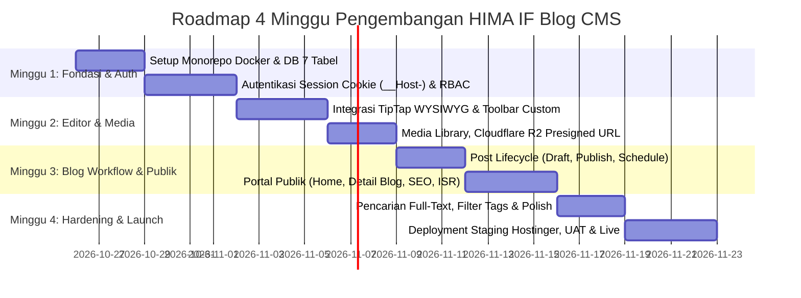

# Rencana Implementasi Bertahap (Sprint Roadmap 1 Bulan) — HIMA IF CMS

| Field | Detail |
|---|---|
| **System** | HIMA IF CMS (Modern WordPress-like Blog Engine) |
| **Document Version** | 2.0.0 |
| **Date** | 2026-10-23 |
| **Status** | Approved Specification |
| **Target Delivery** | 4 Sprint Mingguan (Total 1 Bulan Rilis Produksi) |
| **Methodology** | Agile Incremental Delivery + Strict Quality Gates |

---

## Riwayat Revisi (Revision History)

| Versi | Tanggal | Penulis / Reviewer | Bagian yang Diubah | Rincian Perubahan (Sebelum vs Sesudah) | Alasan Perubahan |
|---|---|---|---|---|---|
| 1.0.0 | 2026-10-13 | Staff Ahli Divisi MIK | Dokumen Baru | Draf awal roadmap implementasi 6 fase bertahap. | Inisiasi perencanaan fase pengembangan. |
| 1.1.0 | 14 Oktober 2026 | Staff Ahli MIK & Auditor | Revisi Deliverables | Integrasi 3 Redis, ES256, Turnstile, booking multi-slot, evaluasi per booking_id. | Penyelarasan hasil audit teknis v2.0.0. |
| 1.2.0 | 14 Oktober 2026 | Staff Ahli MIK & Implementer | Quality Gates Fase 1 | 7 Quality Gates Fase 1, penundaan storage, grace period refresh, UI placeholder. | Sinkronisasi keputusan implementasi. |
| 1.3.0 | 14 Oktober 2026 | Staff Ahli MIK & Lead QA | Konsistensi Tabel | Standarisasi 12 tabel riil migrasi 003, Tailwind v3.4.x, kriteria pengujian Fase 2-6. | Harmonisasi lintas dokumen. |
| 2.0.0 | 2026-10-23 | Staff Ahli MIK & Antigravity Lead | Seluruh Dokumen | **Sebelum:** Roadmap 6 fase bertahap untuk modul interview & rekrutmen massal. **Sesudah:** Restrukturisasi total menjadi Roadmap Sprint 4 Minggu terukur (1 Bulan) murni Blog CMS modern sekelas WordPress, adopsi TipTap WYSIWYG, integrasi Cloudflare R2, eliminasi Celery, dan quality gates mingguan yang realistis diselesaikan mahasiswa. | Pivot arsitektur WordPress-like Blog CMS, eliminasi modul interview, dan kepastian rilis tepat waktu. |

---

## 1. Roadmap Sprint 4 Minggu (Target 1 Bulan Rilis)

---

## 2. Rincian Deliverables per Sprint & Quality Gates

### Sprint 1: Fondasi Arsitektur, Database & Autentikasi Sesi (Minggu 1)
**Tujuan**: Menyiapkan containerization Docker Compose ramping, database PostgreSQL 16 (7 tabel murni blog), dan autentikasi sesi berbasis cookie Host-Only (`__Host-himaif_session`).

- **Deliverables**:
  1. Konfigurasi `docker-compose.yml` (PostgreSQL 16, 1 instance Redis 7, Nginx reverse proxy single-origin).
  2. Migrasi database Alembic terurut:
     - `001_auth_and_sessions.py` (`users`, `sessions`, `auth_audit_logs`)
     - `002_blog_cms_and_media.py` (`blog_categories`, `blog_tags`, `blog_post_tags`, `media_assets`, `blog_posts`, `blog_post_revisions`).
  3. Script seeder `app/db/seed.py`: Akun `SUPER_ADMIN` awal dengan flag `must_change_password=true` dan kategori default.
  4. Backend endpoints: `/auth/login`, `/auth/logout`, `/auth/me`, `/auth/change-password`, guard `must_change_password`, dan rate limit login (5 req/menit via Redis).
  5. Frontend Next.js 15: Setup Tailwind CSS v3.4.x, komponen shadcn/ui, `src/middleware.ts` untuk routing UX, dan halaman login interaktif.
- **Quality Gate 1 (Kriteria Kelulusan Minggu 1)**:
  - [ ] Migrasi database `alembic upgrade head` berjalan sukses tanpa error.
  - [ ] Login mengembalikan respons cookie `__Host-himaif_session` dengan atribut `HttpOnly`, `Secure`, `SameSite=Lax`, dan tanpa atribut `Domain`.
  - [ ] Password tersimpan dalam hash Argon2id (bukan bcrypt/plaintext).
  - [ ] Pengguna baru tidak dapat mengakses endpoint artikel sebelum menyelesaikan `POST /auth/change-password`.

---

### Sprint 2: TipTap WYSIWYG Editor, Sanitasi Rust `nh3` & Media Library (Minggu 2)
**Tujuan**: Membangun antarmuka penulisan visual sekelas WordPress Gutenberg dan pipeline upload gambar direct-to-storage ke Cloudflare R2.

- **Deliverables**:
  1. Integrasi **TipTap Headless Editor** di Next.js: Toolbar formatting (Headings, Bold, Italic, Code Block, Table, Blockquote, Divider, Embed YouTube/Spotify).
  2. Implementasi **Sanitasi Ganda Backend**: Pustaka Rust `nh3` menyaring tag, atribut, dan skema URL berbahaya dari HTML artikel sebelum disimpan ke database.
  3. Larangan mutlak berkas `.svg` dan validasi signature biner (*magic bytes*) pada upload media.
  4. Endpoint Presigned URL S3v4: `POST /api/v1/media/presign-upload` (kalkulasi HMAC-SHA256 in-memory) dan `POST /api/v1/media/confirm-upload`.
  5. UI Media Library di Dashboard Admin: Galeri gambar, tombol salin link relatif, dan dialog penyisipan gambar ke editor.
- **Quality Gate 2 (Kriteria Kelulusan Minggu 2)**:
  - [ ] Injeksi payload XSS (``, ``) terbukti dilucuti 100% oleh sanitizer `nh3` di backend.
  - [ ] Upload berkas `.svg` atau file palsu (contoh: binary `.exe` diubah ekstensi `.jpg`) ditolak dengan kode `HTTP 422`.
  - [ ] Upload gambar berhasil langsung ke Cloudflare R2 via Presigned URL tanpa melewati CPU/bandwidth server VPS.
  - [ ] Gambar disisipkan ke editor menggunakan **Kontrak Path Relatif** (`/storage/public/{id}.webp`).

---

### Sprint 3: Alur Siklus Artikel (Post Lifecycle) & Portal Publik (Minggu 3)
**Tujuan**: Menyelesaikan alur penerbitan artikel (Draft, Publish Mandiri, Schedule) dan portal berita publik HIMA IF dengan kecepatan muat tinggi (LCP < 1.5s).

- **Deliverables**:
  1. CRUD Artikel di Backend: Endpoints `/posts/*` dengan perlindungan anti-IDOR (Author hanya boleh memutasi artikelnya sendiri).
  2. **Alur Kerja Mandiri Author**: Endpoint `PATCH /posts/{id}/publish` dan `PATCH /posts/{id}/schedule` dapat dieksekusi langsung oleh Author pemilik artikel.
  3. Penjadwalan Tayang Bebas Celery: Kueri publik otomatis menyajikan artikel `SCHEDULED` yang `published_at <= NOW()`.
  4. Riwayat Revisi: Pencatatan snapshot perubahan artikel di tabel `blog_post_revisions`.
  5. Portal Publik Next.js (SSR): Homepage HIMA IF, Arsip Berita (`/blog`), Halaman Detail Artikel (`/blog/[slug]`), dan Filter Kategori (`/categories/[slug]`).
  6. Optimasi SEO: Dynamic `sitemap.xml`, `robots.txt`, OpenGraph image, dan kalkulasi otomatis estimasi waktu membaca (*Reading Time*).
- **Quality Gate 3 (Kriteria Kelulusan Minggu 3)**:
  - [ ] Uji otorisasi IDOR: Akun Author A mendapat respons `HTTP 403 Forbidden` saat mencoba mengedit atau menghapus artikel Author B.
  - [ ] Artikel terjadwal otomatis tampil di portal publik saat waktu jam tayang terlampaui tanpa perlu restart server atau cron Celery.
  - [ ] Audit Google Lighthouse pada halaman detail artikel publik meraih skor Performance $\ge 90$ dan SEO = 100.
  - [ ] Nginx proxy cache SSD lokal `/storage/public/*` menghasilkan header `X-Cache-Status: HIT` pada pemuatan gambar berulang (< 10 ms).

---

### Sprint 4: Pencarian Full-Text, Hardening Keamanan, Deployment & UAT (Minggu 4)
**Tujuan**: Menambahkan fitur pencarian cerdas, menyelesaikan pengujian penerimaan pengguna (UAT), dan deployment produksi di VPS Hostinger (Staging).

- **Deliverables**:
  1. Pencarian Full-Text PostgreSQL: Indeks GIN pada kolom `title` dan `excerpt` menggunakan konfigurasi teks bahasa Indonesia.
  2. Hardening Ingress & Security Headers: `X-Frame-Options: SAMEORIGIN`, `X-Content-Type-Options: nosniff`, `Content-Security-Policy`.
  3. Mitigasi Sibling Subdomain CSRF: Middleware validasi `Sec-Fetch-Site: same-origin` dan header `X-Requested-With`.
  4. Pengujian Penerimaan Pengguna (UAT) bersama pengurus Divisi Media Informasi & Kreatif (MIK).
  5. Eksekusi deployment produksi Tahap 1 di VPS Hostinger (`himaif.my.id`) menggunakan SSL Certbot otomatis.
- **Quality Gate 4 (Kriteria Kelulusan Minggu 4)**:
  - [ ] Fitur pencarian artikel berfungsi instan (< 50 ms) untuk kata kunci judul dan isi.
  - [ ] Sistem lolos audit keamanan automated test: zero critical/high vulnerabilities.
  - [ ] Pengurus MIK berhasil melakukan alur: Login $\to$ Tulis Artikel $\to$ Upload Gambar R2 $\to$ Terbitkan Mandiri $\to$ Artikel tampil di domain publik.
  - [ ] Seluruh konfigurasi `.env` dan script transfer database disiapkan untuk transisi mulus ke VPS Kampus Telkom University di masa mendatang.

Roadmap ini realistis, terukur, dan memprioritaskan deliverable fungsional mingguan tanpa overengineering.
