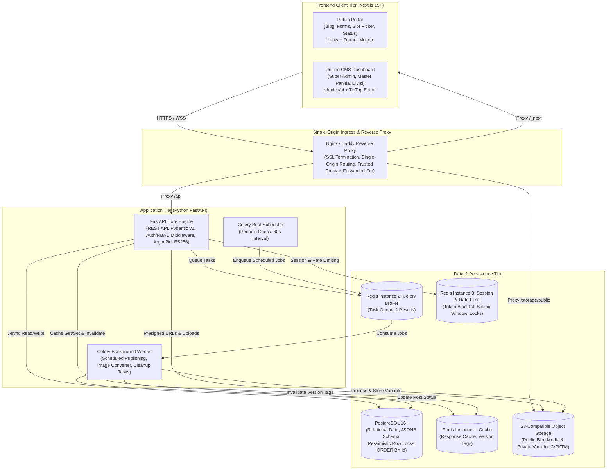
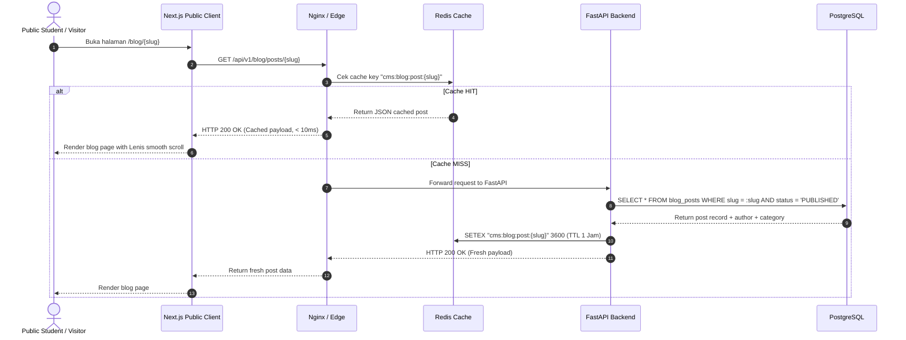
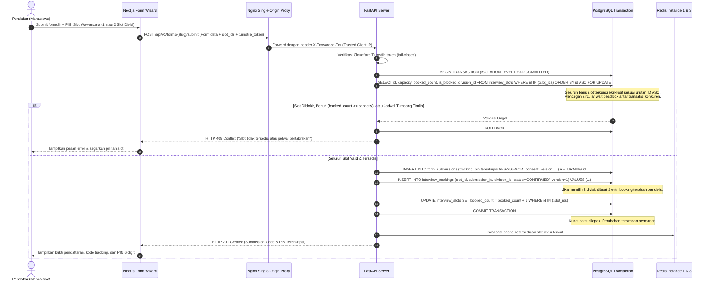
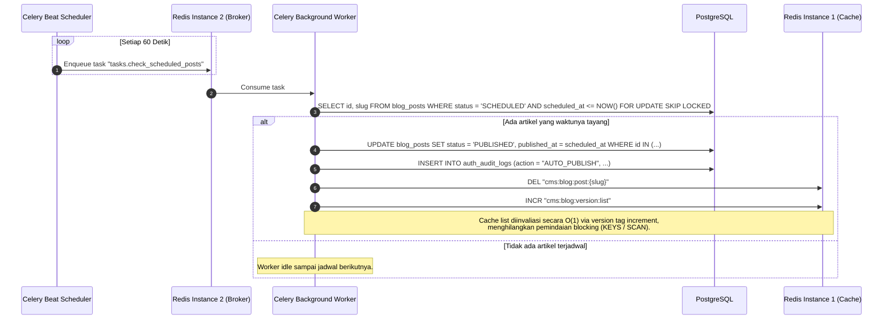

# System Architecture & Technical Blueprint — HIMA IF CMS

| Field | Detail |
|---|---|
| **System** | HIMA IF CMS (Content Management & Recruitment System) |
| **Document Version** | 2.0.0 |
| **Date** | 2026-10-14 |
| **Status** | Implementation-Ready Technical Plan |
| **Target Organization** | HIMA IF Telkom University (Himpunan Mahasiswa Informatika) |
| **Primary Maintainer & Designer** | Staff Ahli Divisi Media Informasi & Kreatif (MIK), Program Kerja Informasite (Informatics Website) HIMA IF Telkom University |

---

## Riwayat Revisi (Revision History)

| Versi | Tanggal | Penulis / Reviewer | Deskripsi Perubahan | Alasan |
|---|---|---|---|---|
| 1.0.0 | 2026-10-13 | Staff Ahli Divisi MIK (Proker Informasite) | Initial Technical Baseline | Dokumen awal perancangan arsitektur sistem |
| 2.0.0 | 2026-10-14 | Staff Ahli Divisi MIK & Antigravity Auditor | Urutan global locking atomik anti-deadlock, reverse proxy single-origin & trusted IP, ES256 JWT, segregasi instance Redis, cache version tag, dan S3-compatible storage | Penyelarasan keputusan final arsitektur dan penutupan celah keamanan |

---

## 1. Executive Summary & Architectural Goals

Website CMS HIMA IF Telkom University dirancang untuk menyelesaikan fragmentasi operasional organisasi mahasiswa informatika. Sistem ini menyatukan dua pilar operasional utama:
1. **Penerbitan Konten & Publikasi Organisasi (Blog CMS)**: Setara dengan WordPress modern, dilengkapi rich block editor (headings, styling, custom HTML, embeds), manajemen kategori, slug unik, alur draft/schedule/publish, optimasi thumbnail bertingkat, serta real-time SEO scoring feedback.
2. **Perekrutan & Manajemen Wawancara Terpusat (Dynamic Forms & Interview Engine)**: Form builder fleksibel tanpa batas input, pembuatan divisi custom, auto-provisioning akun divisi berbasis identitas pseudo-email, penjadwalan interview dengan slot blocking, question builder penilaian custom, dan workspace evaluasi real-time.

### Prinsip Utama Arsitektur:
- **Zero-Cost Baseline & Resource Efficiency**: Dapat dijalankan pada infrastruktur hemat biaya (single VPS atau managed cloud tier) dengan Docker Compose.
- **Strict Data Isolation (Multi-Tenant Kepanitiaan)**: Data pendaftar dan evaluasi terisolasi secara ketat per formulir dan per divisi menggunakan Role-Based Access Control (RBAC) pada level aplikasi dan database.
- **Pseudo-Account System**: Login identifier berbentuk email internal tanpa ketergantungan pada mail server (SMTP), verifikasi email pihak ketiga, atau DNS record eksternal.
- **High Concurrency & Atomic Slot Booking**: Mencegah double-booking jadwal wawancara saat pembukaan pendaftaran massal dengan penguncian baris pesimistik (*pessimistic row locking*) di PostgreSQL dengan urutan global anti-deadlock.
- **Performance First**: Optimasi Core Web Vitals (LCP < 1.5s, CLS = 0) dengan Next.js App Router, caching Redis berbasis version tag, dan automated image processing pipeline (WebP/AVIF + LQIP).

---

## 2. High-Level Component Architecture

Arsitektur sistem dibangun menggunakan model **Decoupled Client-Server Monorepo**, memisahkan presentation layer (Frontend) dan domain logic layer (Backend API) di balik Reverse Proxy satu origin dengan database relasional, in-memory caching, dan distributed task queue.



---

## 3. Technology Stack & Technical Rationale

| Layer / Komponen | Teknologi Terpilih | Versi | Alasan Pemilihan & Manfaat Teknis |
|---|---|---|---|
| **Frontend Framework** | Next.js (App Router, React 19) | 15.x / 19.x | Mendukung Server-Side Rendering (SSR) untuk SEO publik, Incremental Static Regeneration (ISR), React Server Components (RSC) untuk payload minimal, dan route handlers yang terintegrasi. |
| **UI Components** | shadcn/ui & Tailwind CSS | 4.x / 3.4+ | Komponen UI accessible (Radix UI primitives), mudah dikustomisasi secara modular, tanpa runtime overhead besar, didukung Tailwind CSS utility classes. |
| **Icons & Motion** | Lucide Icons & Framer Motion | Latest | Ikonik modern konsisten, visual transitions mulus untuk modal, drawer, form wizard, dan accordion. |
| **Smooth Scrolling** | Lenis Scroll | 1.1+ | Memberikan pengalaman interaksi premium pada landing page publik dan artikel blog tanpa merusak native scroll event pada mobile touch screens. |
| **Rich Text Editor & Sanitizer** | TipTap (ProseMirror based) + `nh3` | TipTap 2.x / `nh3` | Headless block-compatible editor, extensible, menghasilkan structured JSON. Sanitasi HTML backend menggunakan `nh3` (Rust ammonia binding, menggantikan `bleach` yang deprecated) untuk proteksi mutlak dari Stored XSS. |
| **Backend Framework** | Python FastAPI | 0.115+ | Framework asinkron berkinerja tinggi berbasis Starlette dan ASGI, serialisasi data cepat via Pydantic v2, auto-generated OpenAPI/Swagger documentation, native async/await. |
| **Database ORM & Migration** | SQLAlchemy (Async) + Alembic | 2.0+ | Dukungan asynchronous queries via `asyncpg`, pengelolaan transaksi murni, dukungan native untuk kolom PostgreSQL `JSONB`, dan version control skema via Alembic. |
| **Relational Database** | PostgreSQL | 16+ | Mesin database relasional enterprise-grade, mendukung JSONB indexing (GIN index), transaction isolation, dan row-level locking (`SELECT ... FOR UPDATE`) untuk slot concurrency. |
| **In-Memory Caching & Broker** | Redis (3 Dedicated Instances) | 7.x | Instance terpisah: (1) Cache respons & version tags, (2) Celery task broker, (3) Session store, lock keys, dan atomic rate-limiting counters. |
| **Task Queue & Scheduler** | Celery + Celery Beat | 5.4+ | Menjalankan task background (schedule posting otomatis, image resizing & compression, data cleanup) tanpa memblokir thread HTTP API request. |
| **Object Storage** | S3-Compatible Object Storage | S3 API | Penyimpanan file berkas (CV pendaftar, lampiran) dan media gambar blog. Mendukung pre-signed URL yang aman. Keputusan produk spesifik (MinIO / Cloudflare R2 / AWS S3) ditandai terbuka di deployment. |
| **Image Processing Engine** | Pillow (PIL) | Latest | Pemrosesan gambar di background worker: deteksi magic bytes, kompresi lossy/lossless, konversi WebP/AVIF, proteksi decompression bomb (`Image.MAX_IMAGE_PIXELS = 16_777_216`), dan pembuatan thumbnail. |
| **Authentication & Tokens** | Asymmetric JWT (`ES256`) + Argon2id | PyJWT / `pwdlib` | Algoritma tanda tangan `ES256` (ECDSA P-256 + SHA-256) dengan pasangan kunci asimetris (private key di backend FastAPI, public key di Next.js untuk UX routing). Password di-hash menggunakan Argon2id (OWASP standard baseline). |

---

## 4. End-to-End Data Flows

### 4.1 Alur Publikasi & Konsumsi Blog Publik (Caching Pipeline)



### 4.2 Alur Pemesanan Slot Wawancara (Atomic Pessimistic Booking & Global Lock Order)

Untuk mencegah dua pendaftar memilih slot wawancara yang sama secara bersamaan (*race condition*), serta mencegah *deadlock* saat transaksi memproses banyak slot (misalnya pendaftar memilih 2 divisi, atau panitia melakukan *reschedule* dan *slot blocking*), sistem menegakkan **Urutan Penguncian Global (Global Lock Order)**:

1. **Kunci Baris Booking Terlebih Dahulu (Bila Ada)**: Pada alur yang memodifikasi reservasi yang sudah ada (*reschedule* atau pemindahan oleh panitia), baris `interview_bookings` dikunci terlebih dahulu via `SELECT ... FOR UPDATE`.
2. **Kunci Baris Slot Terurut Berdasarkan ID**: Penguncian baris pada `interview_slots` **WAJIB** mengeksekusi:
   ```sql
   SELECT id, capacity, booked_count, is_blocked, division_id, start_time, end_time
   FROM interview_slots 
   WHERE id IN (:slot_ids) 
   ORDER BY id ASC 
   FOR UPDATE;
   ```
   *Alasan Arsitektur (Anti-Deadlock):* Mengurutkan ID slot secara ascending (`ORDER BY id ASC`) menjamin seluruh transaksi konkuren memperoleh *row-level locks* dalam urutan fisik yang seragam, secara matematis mengeliminasi risiko *circular-wait deadlock* ketika dua pendaftar secara simultan memesan pasangan slot yang saling bersilangan.
3. **Validasi Atomik All-or-Nothing Setelah Kunci Diperoleh**: Seluruh evaluasi aturan bisnis dijalankan di dalam blok transaksi setelah baris terkunci:
   - Kapasitas: `booked_count < capacity`.
   - Status blokir: `is_blocked == FALSE`.
   - Validitas divisi: `division_id` sesuai dengan pilihan formulir.
   - Anti-overlap: Jika pendaftar memilih 2 divisi (Divisi Utama dan Divisi Kedua), waktu mulai dan selesai kedua slot diverifikasi tidak saling bertabrakan (*non-overlapping*).
   Jika salah satu validasi gagal, seluruh transaksi di-`ROLLBACK` secara utuh.



---

### 4.3 Alur Background Task: Scheduled Blog Publishing (Version Tag Invalidation)



---

## 5. Security & Network Topology

```mermaid
graph LR
    subgraph PublicInternet["Public Internet"]
        Users["Web Browsers\n(Mahasiswa & Pengurus)"]
    end

    subgraph DMZ["Single-Origin Ingress & Edge Proxy"]
        ReverseProxy["Nginx / Caddy Reverse Proxy\nDomain: himaif.id\nPorts: 80, 443 (TLS 1.3 Termination)\nTrusted X-Forwarded-For Injection\nRate Limiting Zone: 20 req/s\nSecurity Headers (HSTS, CSP, XFO)"]
    end

    subgraph InternalAppNet["Private Internal Docker Network (himaif-internal)"]
        FrontendService["Next.js 15+ Node Container\nPort: 3000 (Internal only)"]
        BackendService["FastAPI Uvicorn Container\nPort: 8000 (--proxy-headers trusted)\nArgon2id + ES256 Engine"]
        WorkerService["Celery Worker Container\nNo exposed ports"]
        
        subgraph RedisCluster["Segregated Redis Instances"]
            RedisCache["Redis Instance 1: Cache\nPort: 6379 (DB 0: Responses & Version Tags)"]
            RedisBroker["Redis Instance 2: Task Broker\nPort: 6380 (Celery Queue & Results)"]
            RedisSession["Redis Instance 3: Session & Rate Limit\nPort: 6381 (JWT Blacklist & Locks)"]
        end
        
        DBService["PostgreSQL 16 Container\nPort: 5432 (Internal only, strictly isolated)"]
        StorageService["S3-Compatible Object Storage\nPort: 9000 (API), 9001 (Console internal)\nPublic Bucket + Private Vault Bucket"]
    end

    Users -->|HTTPS 443 (Single Origin)| ReverseProxy
    ReverseProxy -->|Route / & /_next| FrontendService
    ReverseProxy -->|Route /api/v1| BackendService
    ReverseProxy -->|Route /storage/public| StorageService

    FrontendService -.->|Internal SSR API calls| BackendService
    BackendService --> DBService
    BackendService --> RedisCache
    BackendService --> RedisBroker
    BackendService --> RedisSession
    BackendService --> StorageService
    WorkerService --> DBService
    WorkerService --> RedisCache
    WorkerService --> RedisBroker
    WorkerService --> StorageService
```

### 5.1 Penentuan IP Klien Asli pada Topologi Single-Origin
Karena seluruh trafik publik masuk melalui reverse proxy tunggal (`https://himaif.id`), aplikasi backend FastAPI berada di belakang proxy internal. Untuk mencegah *IP Spoofing*:
1. **Aturan Proxy Tepercaya**: Nginx dikonfigurasi untuk menyetel header `X-Forwarded-For: $proxy_add_x_forwarded_for` dan `X-Real-IP: $remote_addr`.
2. **Konfigurasi Uvicorn / FastAPI**: Uvicorn dijalankan dengan flag `--proxy-headers` dan parameter `--forwarded-allow-ips="172.18.0.0/16"` (hanya mempercayai subnet Docker gateway internal).
3. **Penegakan Rate Limit & Anti-Bot**: Seluruh kalkulator pembatas request (Redis sliding window) dan parameter `remoteip` Cloudflare Turnstile wajib mengekstrak IP klien dari `request.client.host` yang telah divalidasi oleh layer proxy tepercaya tersebut.

### 5.2 Kebijakan CORS pada Topologi Satu Origin
Karena frontend publik dan API backend berada di bawah origin yang sama (`https://himaif.id` dengan path `/api/v1`), permintaan browser secara bawaan berstatus *same-origin*.
FastAPI `CORSMiddleware` dikonfigurasi secara ketat:
- `allow_origins = ["https://himaif.id", "http://localhost:3000"]` (hanya domain resmi dan lingkungan lokal development).
- `allow_credentials = True` (mendukung pengiriman HttpOnly cookie `refresh_token`).
- `allow_methods = ["GET", "POST", "PUT", "PATCH", "DELETE", "OPTIONS"]`.
- `allow_headers = ["Authorization", "Content-Type", "X-Requested-With", "X-CSRF-Token"]`.

### 5.3 Akses S3-Compatible Storage pada Topologi Satu Origin
- **Keputusan Produk Storage**: Ditandai `BELUM DIPUTUSKAN` (kandidat: MinIO self-hosted, Cloudflare R2, atau AWS S3).
- **Akses Berkas Publik**: Aset artikel blog publik di-cache dan di-proxy melalui rute Nginx `/storage/public/*` sehingga browser mengaksesnya langsung dari origin utama tanpa eksposur kredensial S3.
- **Akses Berkas Privat (CV/KTM Pelamar)**: Browser memanggil endpoint terproteksi `GET /api/v1/media/{id}/download-url`. Backend memverifikasi otorisasi RBAC dan menerbitkan *short-lived presigned URL* (masa berlaku 5 menit) langsung ke bucket privat vault.

### 5.4 Batasan Akses Jaringan & Security Headers:
1. **Port PostgreSQL & 3 Instance Redis Tidak Terbuka ke Publik**: Hanya dapat diakses oleh kontainer dalam private Docker network `himaif-internal`.
2. **Reverse Proxy Security Headers**:
   - `Content-Security-Policy`: Mengizinkan script Cloudflare Turnstile (`https://challenges.cloudflare.com`), style yang sah, dan melarang inline executable tanpa nonce.
   - `X-Frame-Options: SAMEORIGIN`: Mencegah clickjacking.
   - `X-Content-Type-Options: nosniff`: Mencegah MIME confusion attacks.
   - `Strict-Transport-Security: max-age=31536000; includeSubDomains`: Menegakkan protokol HTTPS.
